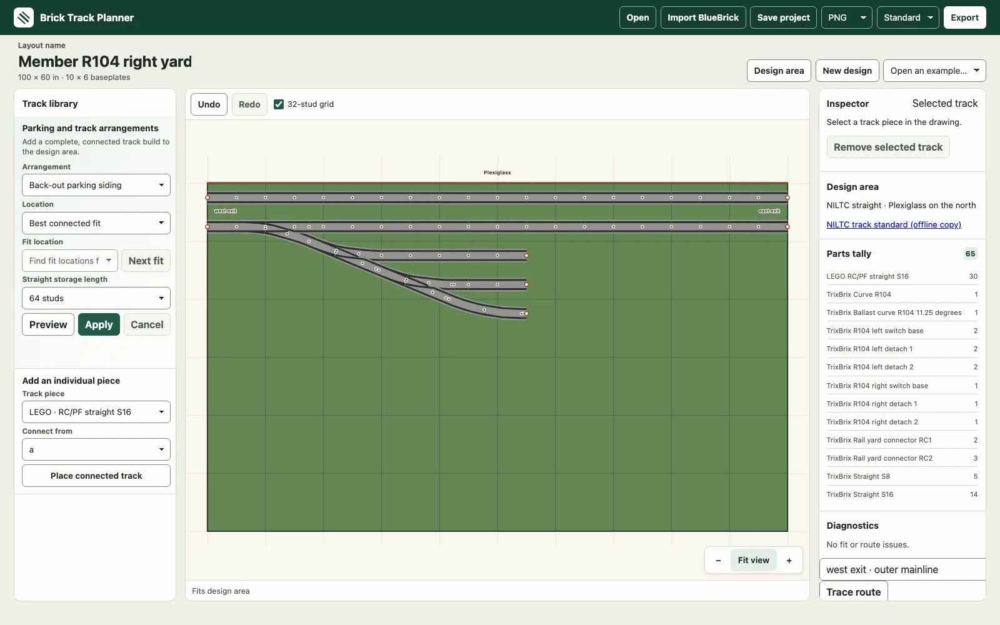

# Brick Track Planner

A browser planner for a LEGO train member's assigned display area. It starts
with the mainline Roger assigned, then helps the member design the actual
track behind it: parking, yards, crossovers, turnouts, and a route back to the
mainline.

## [https://vosslab.github.io/brick-track-planner/](https://vosslab.github.io/brick-track-planner/)

Choose **60 x 40 Straight** or **60 x 40 Curve**, or enter another assigned
width and depth. The planner covers the design area in baseplate cells, lays
the NILTC dual mainline, and keeps the track plan inside that area.

## Design useful track




- Start with the member's display area, its plexiglass-facing edge, and the
  straight or R120/R104 curve assigned for the show.
- Add complete track arrangements made from physical pieces: parking sidings,
  double crossovers, aligned triple switches, genuine R104 wyes, and
  double-ended four-track yards.
- Trace a route from a selected siding or yard track back to a mainline exit.
- Check track connector joins, height, area overhang, the protected mainline,
  and NILTC mainline event spacing: 16 studs between events, or 64 studs after
  an S-curve.
- Keep the same placed parts in the drawing, route trace, inventory, build
  sheet, and exports.

The yard image is the supplied **Member R104 right yard** example: a measured,
single-ended R104 fan behind the mainline. The separate four-track
drive-through arrangement is the double-ended storage option.

The catalog includes current plastic RC/PF-compatible LEGO, BrickTracks, and
TrixBrix track. It does not include 9V track. R40 and R56 pieces are useful in
private yards and general layouts. NILTC mainline corners use R120 outside and
R104 inside. The standards source used by the planner is saved as an
[offline NILTC track specification](docs/references/niltc-track-specifications/index.html),
including its local diagrams.

## Quick start

Use Node.js 26 with npm 12, Rust, the `wasm32-unknown-unknown` target, and
`wasm-pack`.

```sh
brew bundle
rustup default stable
rustup target add wasm32-unknown-unknown
npm ci --no-audit
./run_web_server.sh
```

Open the local URL printed by the server. Start a **60 x 40 Straight** area,
then choose **Back-out parking siding** from the arrangement tools. The preview
offers a connected fit before it changes the drawing. For a double-ended yard,
use a **100 x 60 Straight** area. At the default 64-stud storage length, the
planner offers three possible locations for one yard. Apply a location, then
trace a route through a storage track. **Rear parking siding** uses seven R40 curves to put a terminal
track behind a 60 x 40 display; it needs the full 40-inch depth.

[`docs/USAGE.md`](docs/USAGE.md) has the full member workflow. The included
examples cover a straight area, a corner, a yard, and a general U-shaped
staging layout. The U layout is an interpretation of the visible track geometry
in [LUK Railway's BlueBrick planning example](https://www.lukrailway.co.uk/wp-content/uploads/2026/06/lego-train-track-planning-software_bluebrick-example.png),
not a reconstruction of unreadable product labels.

## Save, import, and share

Save an editable design as `.btp.json` and reopen it in another browser.
Import a supported BlueBrick Map v9 `.bbm` as track in one design area.
Unsupported imported pieces remain identified so the member can replace or
remove them deliberately.

PDF produces a member build sheet with the design area, public edge, mainline
exits, track plan, and parts list. PNG and WebP export the drawing. LDraw
exports mapped physical track and reports custom or unmapped pieces. See
[`docs/FILE_FORMAT.md`](docs/FILE_FORMAT.md) for the data contract.

## Development

```sh
./build_github_pages.sh
./check_codebase.sh
./run_playwright_tests.sh
```

`build_github_pages.sh` regenerates the Wasm bindings and stages the Pages
artifact. The browser tests serve that staged build.

## License

Source code uses [AGPL-3.0](LICENSE.AGPL-3.0). Original documents, screenshots,
and other creative material use [CC BY 4.0](LICENSE.CC-BY-4.0).

## Documentation

- [Usage](docs/USAGE.md)
- [File format](docs/FILE_FORMAT.md)
- [Geometry model](docs/GEOMETRY_MODEL.md)
- [Track catalog sources](data/CATALOG_SOURCES.md)
- [Ballast references](data/BALLAST_SOURCES.md)
