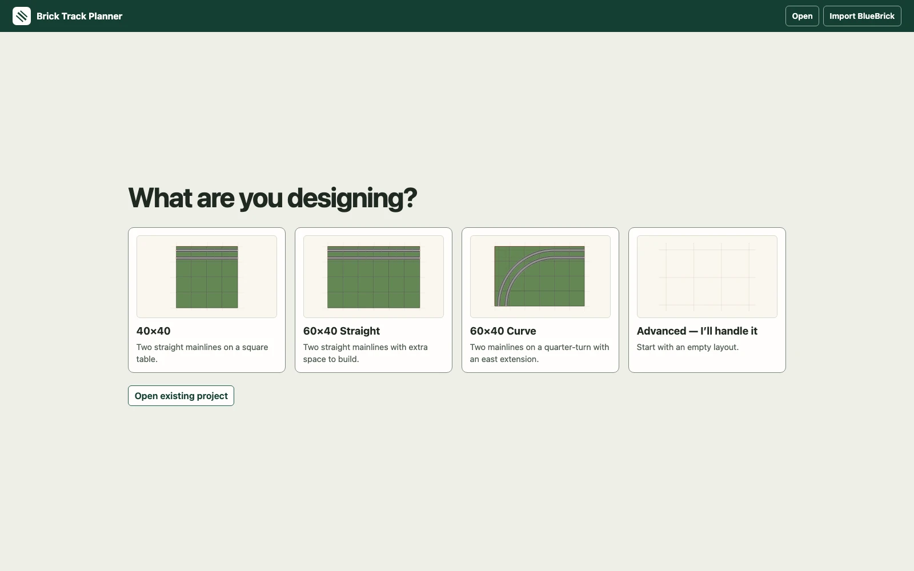
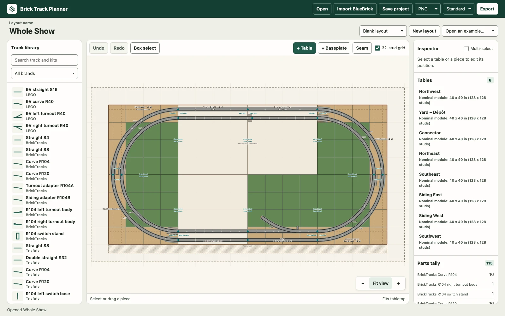

# Brick Track Planner

A browser planner for NILTC members to design LEGO-compatible train sections, join them into a show,
and produce setup sheets and bring lists from one accurate top-down layout.

## [https://vosslab.github.io/brick-track-planner/](https://vosslab.github.io/brick-track-planner/)

Open the hosted planner to start a NILTC layout, open a saved project, or try the Whole Show
example. The screenshots below were captured from the local Pages build.

## Screenshots

<!-- screenshots:begin (managed by screenshot-docs) -->

**Choose a starter.** Start with straight or curved NILTC mainlines, or open a blank layout.



**Assemble a show.** The Whole Show example joins eight tables around two mainlines.



<!-- screenshots:end -->

## Plan a club show

- Start on a 40 x 40 table, a 60 x 40 straight or curved section, or an advanced blank layout.
  Choose **Add a siding** on either straight starter to add a connected branch in one step.
- Place NILTC mainlines on their standard guides, then build sidings and yards with connector-based
  snapping.
- Mix LEGO, BrickTracks, TrixBrix, and measured 4DBrix launch pieces, including R104 and R120 curves.
- Exchange independent section bundles, position them in a venue, and repair named dual-mainline joins.
- Check table fit, tabletop support, track gaps, height differences, and each member's bring list.
- Share the complete plan as a PDF setup packet, PNG, WebP, or track-only LDraw export.

## Quick start

Use Node.js 26 with npm 12, Rust, the `wasm32-unknown-unknown` target, and `wasm-pack`. On macOS,
install the Homebrew tools with `brew bundle`, then install JavaScript dependencies.

```sh
brew bundle
rustup default stable
rustup target add wasm32-unknown-unknown
npm ci --no-audit
./run_web_server.sh
```

Open the local URL printed by the server. Choose **Advanced -- I'll handle it**, then select
**Whole Show** under **Open an example...**. In **Sections & exits**, move **Connector** from X `288`
to `290`. The app shows four broken lanes and the unsupported strip beneath the Yard S8; **Undo**
restores the assembled show. The [docs/USAGE.md](docs/USAGE.md) walkthrough covers the complete
section, venue, inventory, save, and export workflow.

## Save, import, and share

Save an editable show as `.btp.json`; export a reusable section as `.btps.json`; and open either
file later in another browser. Import a BlueBrick Map v9 `.bbm` as a starting point. Unsupported
parts remain visible as unresolved items, so their source identity survives save and reopen.

PDF produces a printable setup packet with table placement, joins, section details, and bring lists.
PNG and WebP export the complete visible layout in Standard or High resolution. LDraw exports mapped
track poses and plate offsets, then reports custom models and unmapped track separately. File details
and compatibility rules are in [docs/FILE_FORMAT.md](docs/FILE_FORMAT.md).

## Examples

The Pages artifact includes four reusable sections and the assembled
[Whole Show](examples/whole_show.btp.json): [Corner](examples/corner.btps.json),
[Yard](examples/yard.btps.json), [Connector](examples/connector.btps.json), and
[Siding](examples/siding.btps.json). It also keeps the compact
[two-section seam](examples/two-section.btp.json), [double corner](examples/double-corner.btp.json),
and [BlueBrick v9 import](examples/bluebrick-example.bbm) examples.

## Release evidence

The local v-final release gate passed Rust formatting, 21 Rust tests, Clippy, the Pages build,
TypeScript checks, 36 Node tests, and 46 Playwright checks. An independent clean-source run also
passed 1,179 repository checks. The full fixture, performance measurements, and reproduction command
are recorded in [docs/active_plans/active/BRICK_TRACK_PLANNER_VFINAL_PROGRESS.md](docs/active_plans/active/BRICK_TRACK_PLANNER_VFINAL_PROGRESS.md).

## GitHub Pages publication

The root [deploy-pages.yml](deploy-pages.yml) is the canonical workflow source. GitHub runs workflow
files from `.github/workflows/`, so copy the root file's contents into
`.github/workflows/deploy-pages.yml` in the GitHub browser and set the repository Pages source to
GitHub Actions. The workflow verifies pull requests, pushes to `main`, and manual runs; deployment
runs on `main` and on manual dispatch from the default branch.

Install Chromium and WebKit with `npx playwright install chromium webkit` for local release checks.
On Linux, use `npx playwright install --with-deps chromium webkit` to include system dependencies.
Run `./devel/verify_release.sh` to build the Pages artifact and run the checks. For standalone
codebase checks, run the build first to generate the Wasm TypeScript declarations.

## Documentation

- [docs/USAGE.md](docs/USAGE.md) -- member and coordinator workflows.
- [docs/FILE_FORMAT.md](docs/FILE_FORMAT.md) -- project, section, import, and export contracts.
- [docs/GEOMETRY_MODEL.md](docs/GEOMETRY_MODEL.md) -- connectors, fit checks, and plate offsets.
- [data/CATALOG_SOURCES.md](data/CATALOG_SOURCES.md) -- supported track geometry and source receipts.
- [docs/active_plans/active/BRICK_TRACK_PLANNER_VFINAL.md](docs/active_plans/active/BRICK_TRACK_PLANNER_VFINAL.md) --
  shipped scope and acceptance criteria.
- [docs/CHANGELOG.md](docs/CHANGELOG.md) -- release history and engineering notes.

## License

Source code: [LICENSE.AGPL-3.0](LICENSE.AGPL-3.0).

Documentation and other non-code materials: [LICENSE.CC-BY-4.0](LICENSE.CC-BY-4.0).
