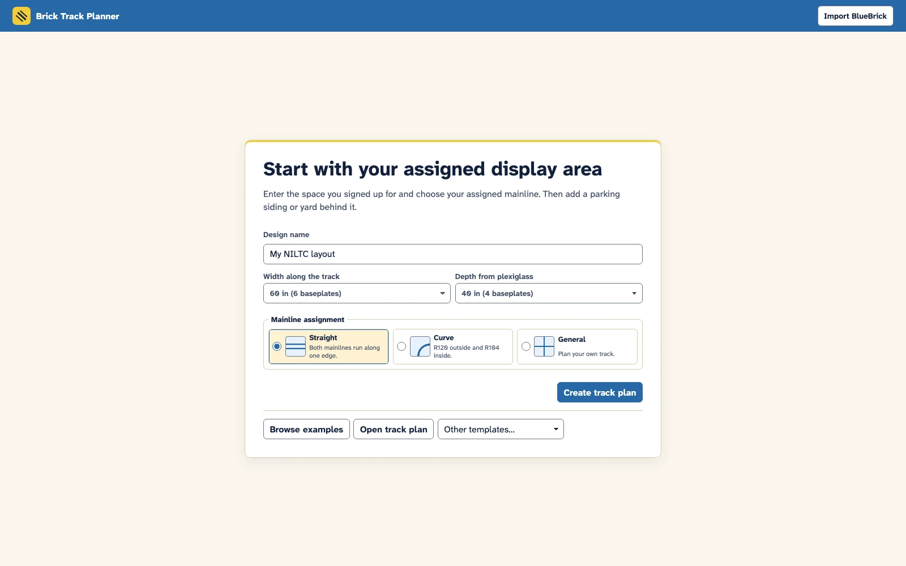

# Brick Track Planner

Plan the track in your LEGO train club display space. Start with the assigned NILTC straight or corner, then connect a parking siding or storage yard and trace a train's route back to the mainline.

[Open the published planner](https://vosslab.github.io/brick-track-planner/).
This project is in pre-production. If the published editor shows **New layout**,
use the [local build](#run-the-current-build) for the **New design** workflow below.

## From mainline to yard

The first view shows a 60 by 40 inch assignment. Two mainlines run along the
plexiglass, and the baseplate grid covers the full area. The **Member yard**
example shows how a single-ended R104 right yard branches off the inner line
to store trains behind the display.

<!-- screenshots:begin (managed by screenshot-docs) -->


<!-- screenshots:end -->

## Quick start

1. Choose **New design**. Keep the 60 inch width along the track, 40 inch
   depth from the plexiglass, and **Straight** assignment. Choose **Create track plan**.
2. Under **Arrangement**, choose **Back-out parking siding**. Set **Location**
   to **Use the mainline** and choose **Preview**. The planner highlights the
   fit and identifies the two straight pieces it will replace.
3. Choose **Apply** to connect the siding, then **Save project** to download an
   editable `.btp.json` file. Use **Open** to return to it later.

For a corner assignment, choose **Curve** and select the public corner. The
starter uses R120 on the outside and R104 on the inside. Choose **General**
to lay your own track on a covered area.

## Plan a larger yard

- To bring trains in at one end and out the other, start a 100 by 60 inch
  straight assignment and preview **Four-track drive-through yard**. With
  64 studs of storage, use **Fit location** to choose where both ends join.
- For a terminal track at the back of a 60 by 40 inch display, **Rear parking
  siding** uses seven R40 curves and the full 40 inch depth. The library also
  includes double crossovers, triple switches, and R104 wyes.
- Choose a mainline exit in **Trace from**, then choose **Trace route** and
  click a storage track connector. Check the highlighted route, the parts tally,
  and any findings about joins, height, or track outside the design area.
- NILTC checks require 16 studs of straight between mainline events such as
  curves or switches, and 64 studs after an S-curve. R40 and R56 curves can serve
  private yards. The catalog covers plastic RC/PF-compatible LEGO, BrickTracks,
  and TrixBrix track.

The included examples cover a straight assignment, a corner, a yard, and a
general U-shaped staging layout. The U shape follows the visible geometry in
[LUK Railway's BlueBrick planning example](https://www.lukrailway.co.uk/wp-content/uploads/2026/06/lego-train-track-planning-software_bluebrick-example.png).

## Save, import, and share

Export a PDF build sheet for the show with the public edge, mainline exits,
track drawing, and parts list. PNG and WebP export the drawing. LDraw exports
mapped track and reports pieces that need a custom model. Importing a supported
BlueBrick Map v9 `.bbm` keeps unrecognized pieces visible for review.

## Run the current build

From a checkout, use Node.js 26 with npm 12, stable Rust, the
`wasm32-unknown-unknown` target, and `wasm-pack`. On macOS the
[Brewfile](Brewfile) lists the tools for `brew bundle`.

```sh
rustup target add wasm32-unknown-unknown
npm ci --no-audit
./run_web_server.sh
```

Open the local address printed by the server and follow the quick start above.
For development, `./devel/verify_release.sh` runs the Rust checks, builds the
Pages site, and runs the TypeScript, Node, and browser checks.
Run `source source_me.sh && pytest tests/` for the repository checks.

## Documentation

- [Member guide](docs/USAGE.md) for signup dimensions, arrangements, and route tracing.
- [Offline NILTC track specifications](docs/references/niltc-track-specifications/index.html) for the straight and corner diagrams.
- [Track catalog sources](data/CATALOG_SOURCES.md) and [ballast references](data/BALLAST_SOURCES.md) for individual parts and assemblies.
- [Geometry model](docs/GEOMETRY_MODEL.md) for connectors and route calculations.
- [File format](docs/FILE_FORMAT.md) for project files and import behavior.

## License

Source code uses [AGPL-3.0](LICENSE.AGPL-3.0). Original documents, screenshots,
and other creative material use [CC BY 4.0](LICENSE.CC-BY-4.0).
