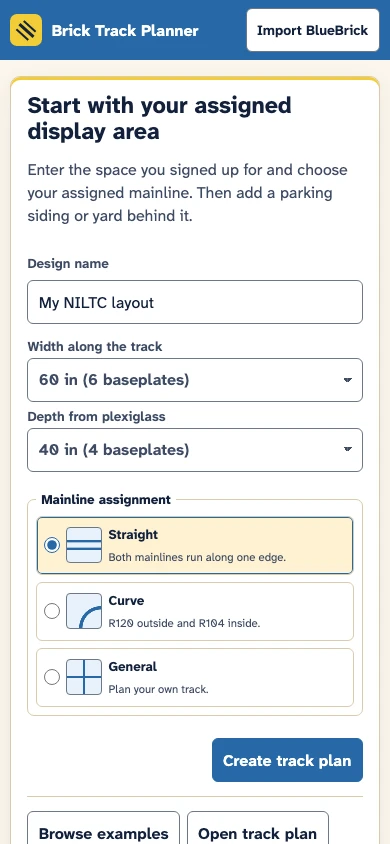
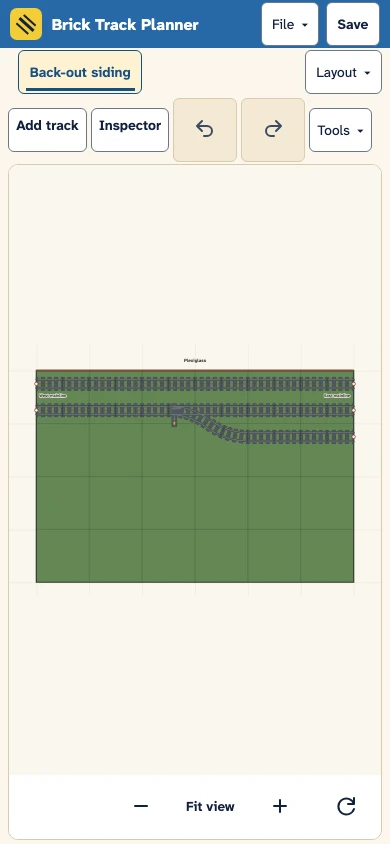
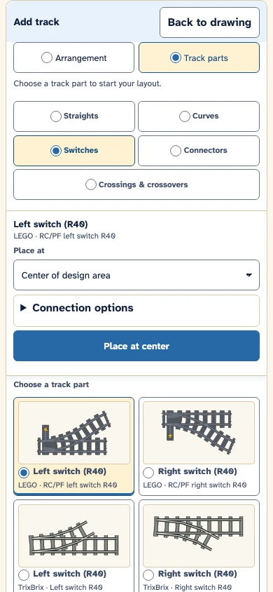

# Phone screenshots

Phone views keep the drawing and the current task visible while menus and
controls adapt to the narrower screen. See the
[desktop screenshot guide](SCREENSHOTS.md) for the full collection.

## Contents

- [Start a plan](#start-a-plan)
- [Use the editor](#use-the-editor)
- [Browse track parts](#browse-track-parts)

## Start a plan

At phone width, the width and depth choices stack so their complete baseplate
counts stay visible.

<!-- screenshots:begin (managed by screenshot-docs) -->

<!-- screenshots:end -->

## Use the editor

The first editor view keeps the drawing dominant. Use **File**, **Layout**, or
**Tools** for commands that are not needed for the current editing step.

<!-- screenshots:begin (managed by screenshot-docs) -->

<!-- screenshots:end -->

## Browse track parts

Choose **Track parts** in a General plan. Pick a visible category, then choose
a card by its drawing and measurement. The smaller manufacturer line identifies
the physical part. Use **Other brands** for an equivalent part or **More track
parts** for a replacement section.

<!-- screenshots:begin (managed by screenshot-docs) -->

<!-- screenshots:end -->
