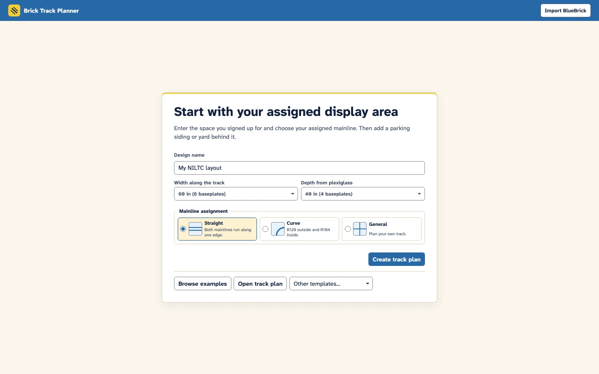
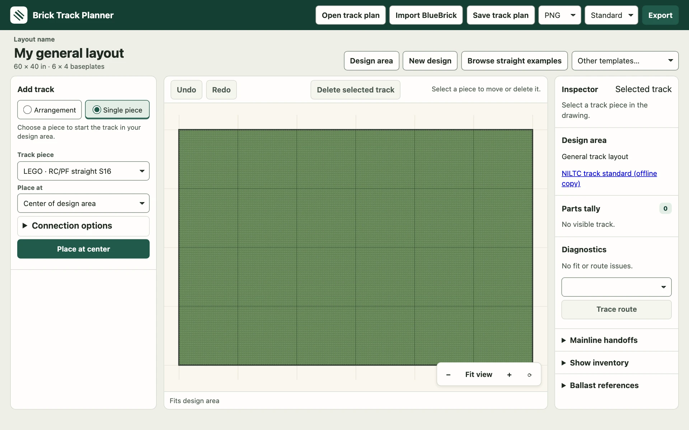
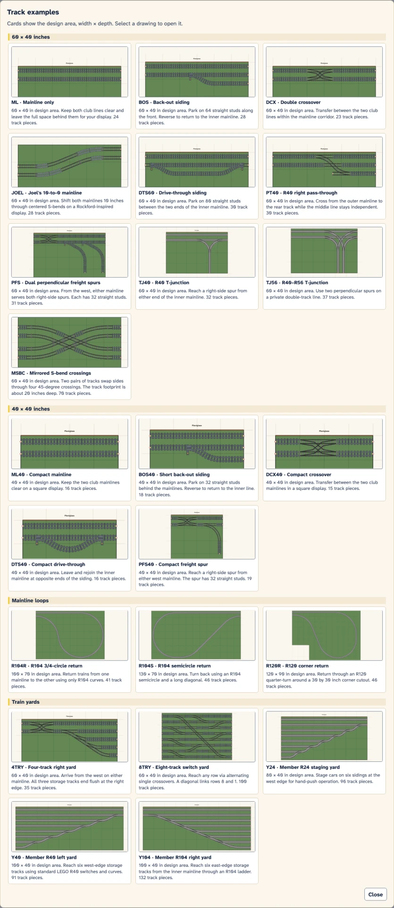
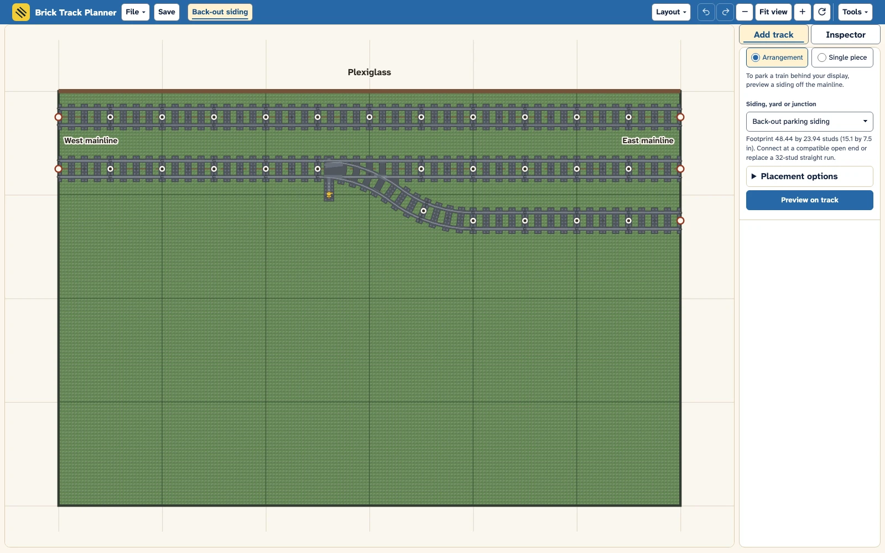
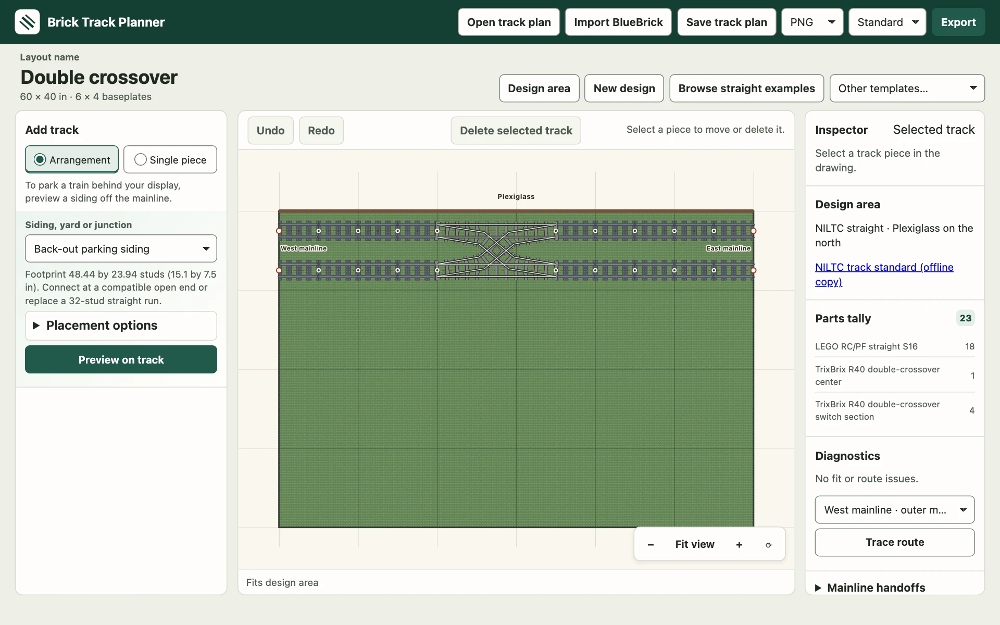
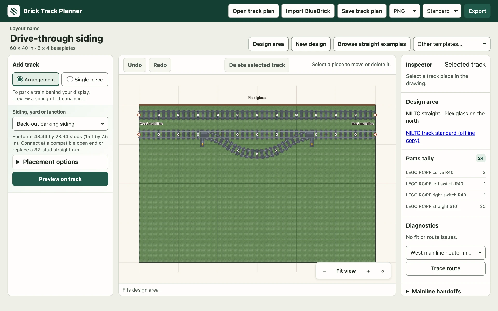
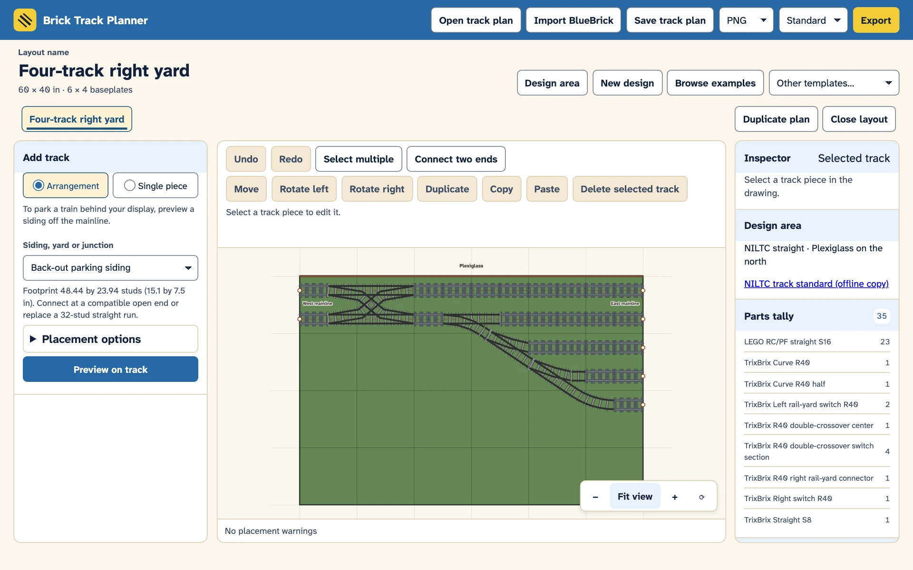
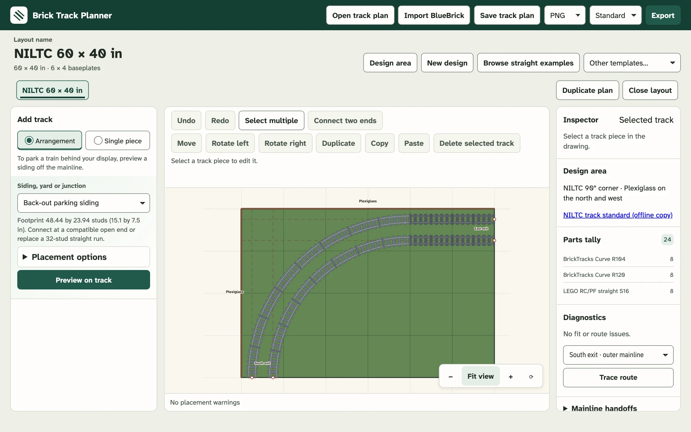
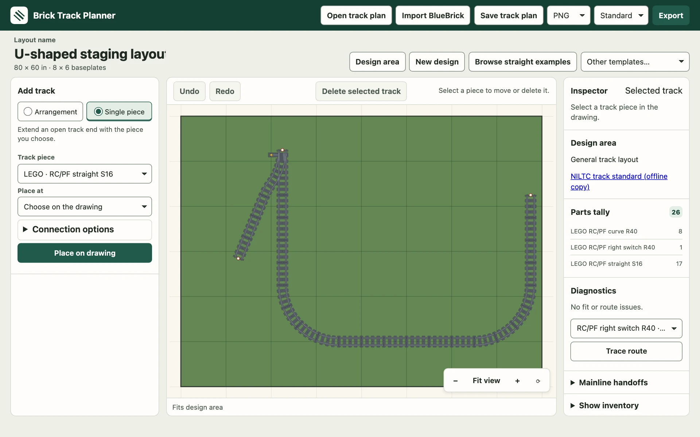
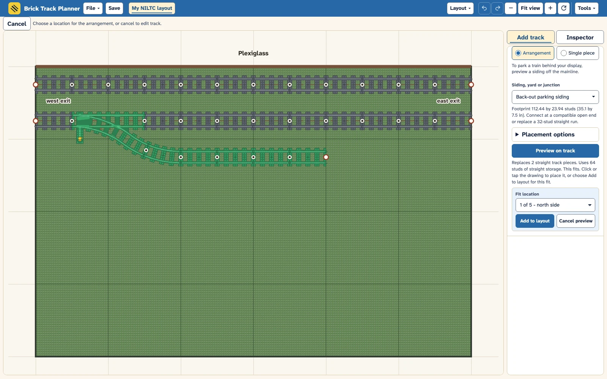

# Planner screenshots

[Start a plan](#start-a-plan) &middot; [60 by 40 inches](#60-by-40-inches)
&middot; [40 by 40 inches](#40-by-40-inches) &middot; [Other templates](#other-templates)
&middot; [Place track](#place-track)

## Start a plan

### Start screen

<!-- screenshots:begin (managed by screenshot-docs) -->

<!-- screenshots:end -->

### Blank General editor

<!-- screenshots:begin (managed by screenshot-docs) -->

<!-- screenshots:end -->

### Straight member starter

<!-- screenshots:begin (managed by screenshot-docs) -->

<!-- screenshots:end -->

## Straight examples

Open these plans with **Browse straight examples**. Both collections use
40 inches of depth. The first number is the width along the track.

<!-- screenshots:begin (managed by screenshot-docs) -->

<!-- screenshots:end -->

### 60 by 40 inches

#### ML - Mainline only

<!-- screenshots:begin (managed by screenshot-docs) -->

<!-- screenshots:end -->

#### BOS - Back-out siding

<!-- screenshots:begin (managed by screenshot-docs) -->

<!-- screenshots:end -->

#### DCX - Double crossover

<!-- screenshots:begin (managed by screenshot-docs) -->

<!-- screenshots:end -->

#### DTS - Drive-through siding

<!-- screenshots:begin (managed by screenshot-docs) -->

<!-- screenshots:end -->

#### PFS - Dual perpendicular freight spurs

<!-- screenshots:begin (managed by screenshot-docs) -->

<!-- screenshots:end -->

#### 4TRY - Four-track right yard

<!-- screenshots:begin (managed by screenshot-docs) -->

<!-- screenshots:end -->

### 40 by 40 inches

#### ML40 - Compact mainline

<!-- screenshots:begin (managed by screenshot-docs) -->

<!-- screenshots:end -->

#### BOS40 - Short back-out siding

<!-- screenshots:begin (managed by screenshot-docs) -->

<!-- screenshots:end -->

#### DCX40 - Compact crossover

<!-- screenshots:begin (managed by screenshot-docs) -->

<!-- screenshots:end -->

#### DTS40 - Compact drive-through

<!-- screenshots:begin (managed by screenshot-docs) -->

<!-- screenshots:end -->

#### PFS40 - Compact freight spur

<!-- screenshots:begin (managed by screenshot-docs) -->

<!-- screenshots:end -->

## Other templates

Open these plans from **Other templates** on the start screen or in the editor.

### Member straight

<!-- screenshots:begin (managed by screenshot-docs) -->

<!-- screenshots:end -->

### Member corner

<!-- screenshots:begin (managed by screenshot-docs) -->

<!-- screenshots:end -->

### Member R104 right yard

<!-- screenshots:begin (managed by screenshot-docs) -->

<!-- screenshots:end -->

### U-shaped staging

<!-- screenshots:begin (managed by screenshot-docs) -->

<!-- screenshots:end -->

## Place track

### Preview and add a siding

<!-- screenshots:begin (managed by screenshot-docs) -->

<!-- screenshots:end -->

### Place a single piece

In the blank General editor, choose **Choose on the drawing** under
**Place at**. Activate **Place on drawing**, then click inside the grid.
The editor adds the selected straight and highlights it.

<!-- screenshots:begin (managed by screenshot-docs) -->

<!-- screenshots:end -->
