# Planner screenshots

[Start a plan](#start-a-plan) &middot; [Place track](#place-track)
&middot; [Select several pieces](#select-several-pieces)
&middot; [Compare two versions](#compare-two-versions)
&middot; [Change the table outline](#change-the-table-outline)
&middot; [Track examples](#track-examples)
&middot; [Other templates](#other-templates)

## Start a plan

### Start screen

To try a layout right away, choose **Browse examples** and pick
**BOS** under **60 &times; 40 inches**. To start your own plan, enter your
assigned display size, choose a track shape, and select **Create track plan**.
Choose **Curve** to see both corner options.

<!-- screenshots:begin (managed by screenshot-docs) -->


<!-- screenshots:end -->

### Phone setup

At phone width, the width and depth choices stack so their complete baseplate
counts stay visible.

<!-- screenshots:begin (managed by screenshot-docs) -->

<!-- screenshots:end -->

### Blank General editor

Choose **General** to start with an empty drawing and add the track
yourself.

<!-- screenshots:begin (managed by screenshot-docs) -->

<!-- screenshots:end -->

### Straight member starter

Choose **Straight** to start with the two shared club tracks already in place.

<!-- screenshots:begin (managed by screenshot-docs) -->

<!-- screenshots:end -->

### Phone editor

The first editor view keeps the drawing dominant. Use **File**, **Layout**, or
**Tools** for commands that are not needed for the current editing step.

<!-- screenshots:begin (managed by screenshot-docs) -->
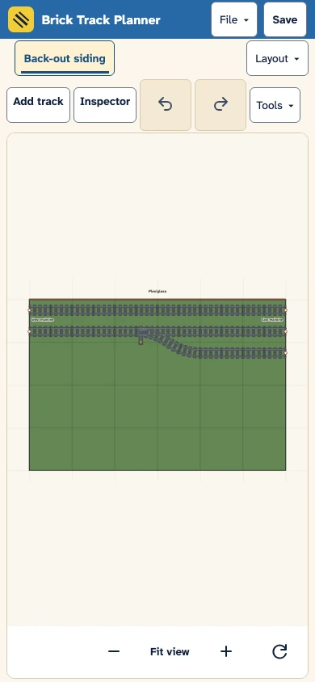
<!-- screenshots:end -->

## Place track

### Preview and add a siding

In a Straight plan, keep **Back-out parking siding** selected. Choose
**Preview on track** to see where the siding fits, then **Add to layout** to
put it in the plan.

<!-- screenshots:begin (managed by screenshot-docs) -->

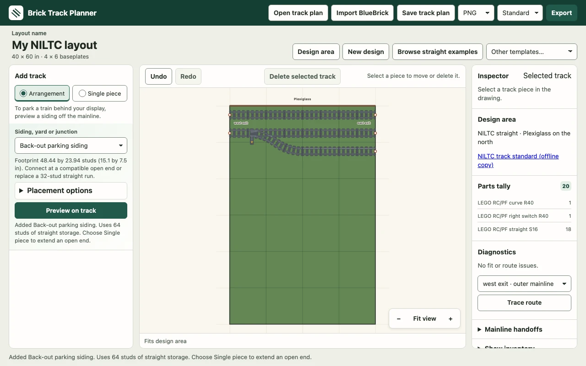
<!-- screenshots:end -->

### Browse track parts

Choose **Track parts** in a General plan. Pick a visible category, then choose
a card by its drawing and measurement. The smaller manufacturer line identifies
the physical part. Point at a desktop card for its exact model, which also
appears in the selected-part summary. Use **Other brands** for an equivalent
part or **More track parts** for a replacement section.

<!-- screenshots:begin (managed by screenshot-docs) -->
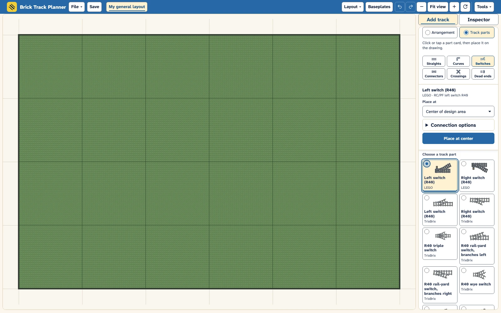

<!-- screenshots:end -->

### Place a track part

In the blank General editor, choose **Choose on the drawing** under
**Place at**. Choose **Place on drawing**, then click or tap the drawing
once. The piece stays where you put it. Select **Move** to reposition it,
or drag it with a mouse.

<!-- screenshots:begin (managed by screenshot-docs) -->

<!-- screenshots:end -->

## Select several pieces

Hold **Command** on Mac or **Ctrl** elsewhere and drag a box that fully
encloses the pieces. Hold the same key and click to add or remove one
piece. On touch, choose **Select multiple** and tap the pieces. Choose
**Move** or **Delete selected track** to act on the whole selection.

<!-- screenshots:begin (managed by screenshot-docs) -->
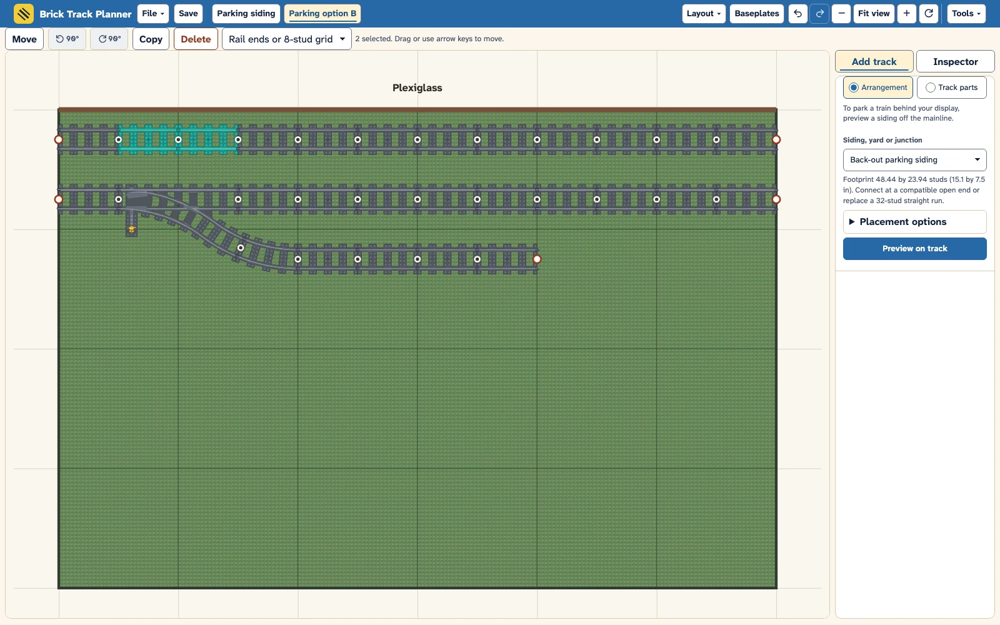
<!-- screenshots:end -->

## Compare two versions

Open **Layout**, choose **Duplicate plan**, and give the copy a short name in
**Layout name**. Edit the copy, then click either tab to compare the two
versions. Use the direct **Save** button from each tab you want to keep.

<!-- screenshots:begin (managed by screenshot-docs) -->

<!-- screenshots:end -->

## Change the table outline

In a Straight plan, open **Layout** and choose **Design area**, select the
north edge, and choose **Shift a span**. Start 10 inches from the left, set
the span to 20 inches, and move it 5 inches toward the selected edge. The
dashed line marks the original outline. The opposite edge moves inward by the
same amount.

<!-- screenshots:begin (managed by screenshot-docs) -->
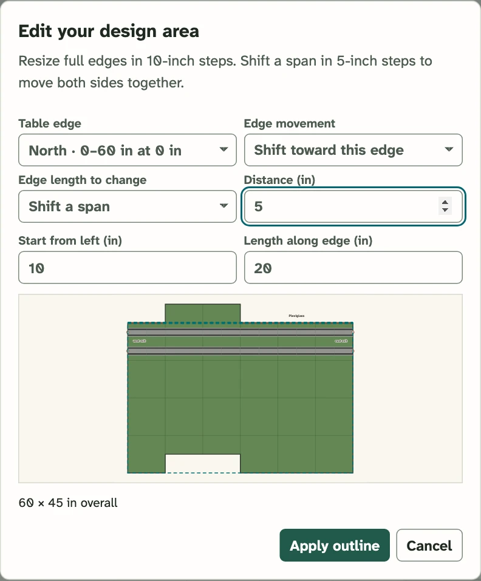
<!-- screenshots:end -->

When the rail handoffs themselves are offset, see [Joel's 10-to-0 mainline](#joels-10-to-0-mainline).

## Track examples

Open these plans with **Browse examples**. The first number is the width
along the track. Jump to [60 by 40 inches](#60-by-40-inches),
[40 by 40 inches](#40-by-40-inches), or [100 by 70 inches](#100-by-70-inches).

<!-- screenshots:begin (managed by screenshot-docs) -->

<!-- screenshots:end -->

### 60 by 40 inches

#### ML - Mainline only

<!-- screenshots:begin (managed by screenshot-docs) -->

<!-- screenshots:end -->

#### BOS - Back-out siding

<!-- screenshots:begin (managed by screenshot-docs) -->

<!-- screenshots:end -->

#### DCX - Double crossover

<!-- screenshots:begin (managed by screenshot-docs) -->

<!-- screenshots:end -->

#### DTS60 - Drive-through siding

<!-- screenshots:begin (managed by screenshot-docs) -->
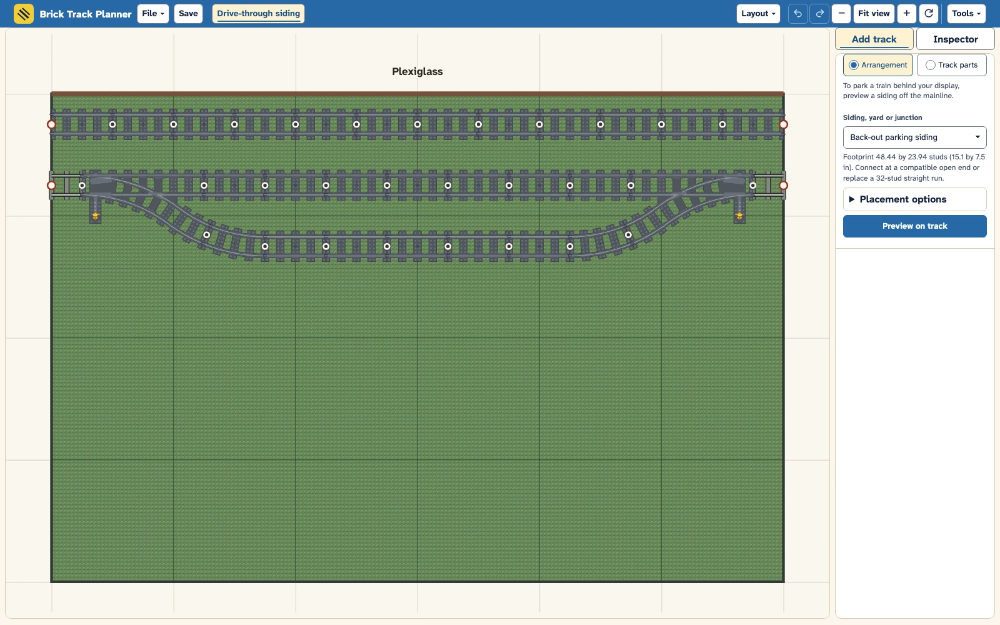
<!-- screenshots:end -->

#### PT40 - R40 right pass-through

<!-- screenshots:begin (managed by screenshot-docs) -->
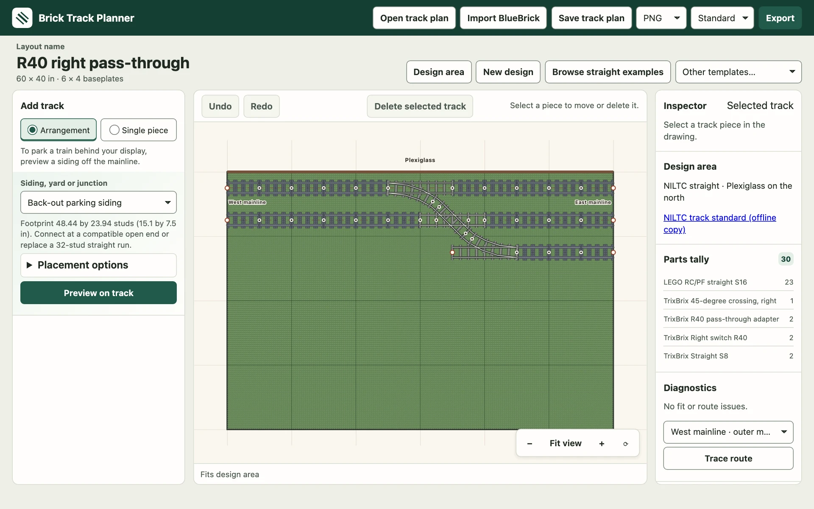
<!-- screenshots:end -->

#### PFS - Dual perpendicular freight spurs

<!-- screenshots:begin (managed by screenshot-docs) -->
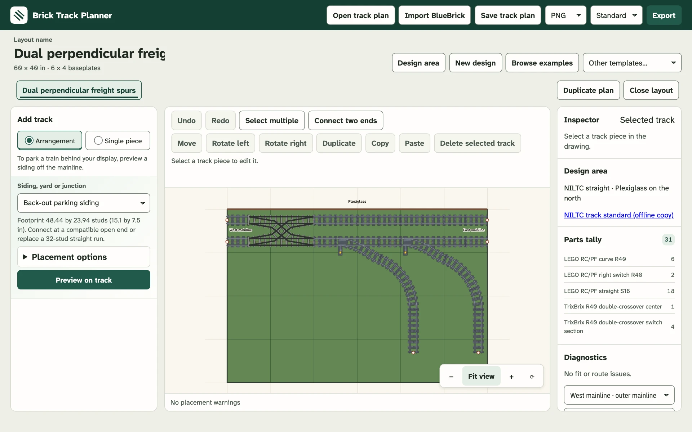
<!-- screenshots:end -->

#### TJ40 - R40 T-junction

<!-- screenshots:begin (managed by screenshot-docs) -->
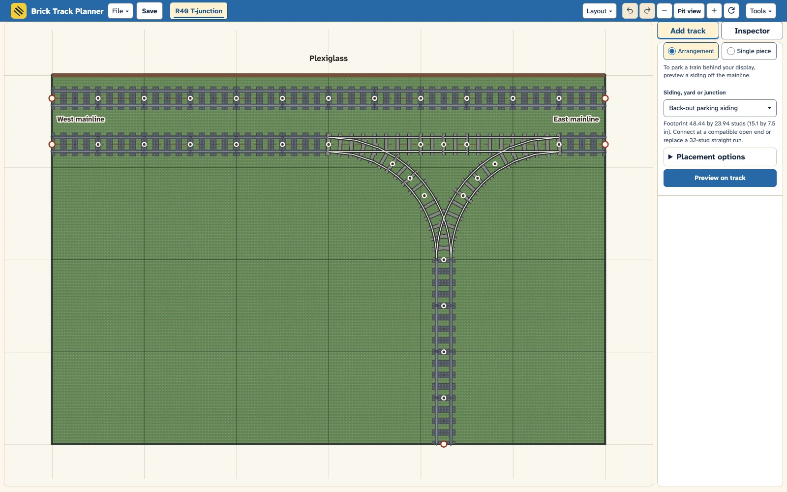
<!-- screenshots:end -->

#### 4TRY - Four-track right yard

<!-- screenshots:begin (managed by screenshot-docs) -->

<!-- screenshots:end -->

#### TJ56 - R40&ndash;R56 T-junction

<!-- screenshots:begin (managed by screenshot-docs) -->
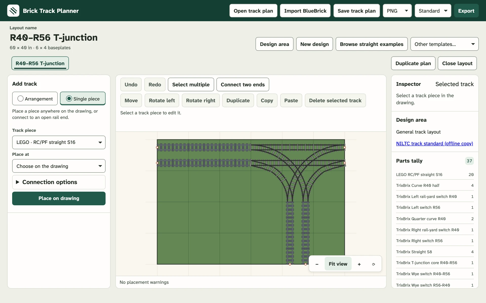
<!-- screenshots:end -->

#### MSBC - Mirrored S-bend crossings

Two pairs of tracks swap sides across a 60 by 40 inch display. The R104 and
R120 S-bends shift each pair about 12.6 inches to leave room for four 45-degree
diamonds. Trains cross the other pair while staying on their own route.
The layout uses stock TrixBrix crossings, curves, and short straights with
LEGO S16 approaches. [Download the editable plan](../templates/mirrored-s-bend-crossings.ldr).

<!-- screenshots:begin (managed by screenshot-docs) -->
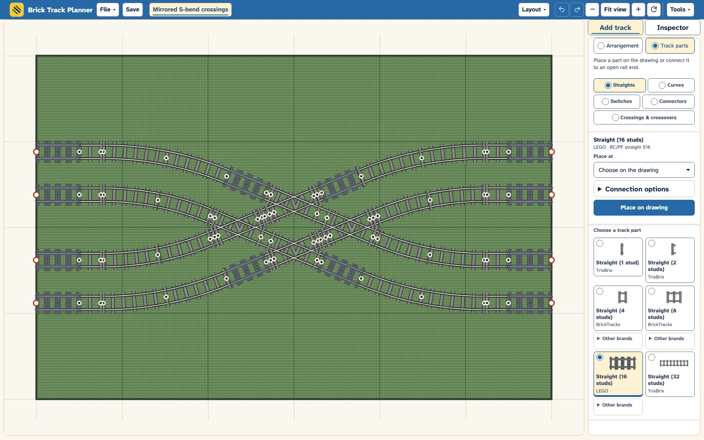
<!-- screenshots:end -->

#### 8TRY - Eight-track switch yard

Eight parallel rows run between the left and right edges. Seven alternating
R40 single crossovers connect adjacent rows. Each uses two matching switches
and a connector. The 45-degree diagonal connects the right end of row 8
directly to the left end of row 1.
([TrixBrix right switch](https://trixbrix.eu/en/p/track/switches-and-crossovers/right-switch-r40/9953-right-switch-r40),
[TrixBrix left switch](https://trixbrix.eu/en/p/track/switches-and-crossovers/switches-and-crossovers-r40/left-switch-r40/9937-left-switch-r40))

Every row is reachable with reversals. To get from row 8 to row 5, run left
to row 7, right to row 6, then left to row 5. Reverse after the train clears
the crossover. The shortest approach at a table edge is 16 studs. Longer trains
may need continuation track beyond the table for some moves. **Trace route**
shows one move at a time.

<!-- screenshots:begin (managed by screenshot-docs) -->

<!-- screenshots:end -->

### 40 by 40 inches

#### ML40 - Compact mainline

<!-- screenshots:begin (managed by screenshot-docs) -->

<!-- screenshots:end -->

#### BOS40 - Short back-out siding

<!-- screenshots:begin (managed by screenshot-docs) -->

<!-- screenshots:end -->

#### DCX40 - Compact crossover

<!-- screenshots:begin (managed by screenshot-docs) -->

<!-- screenshots:end -->

#### DTS40 - Compact drive-through

<!-- screenshots:begin (managed by screenshot-docs) -->
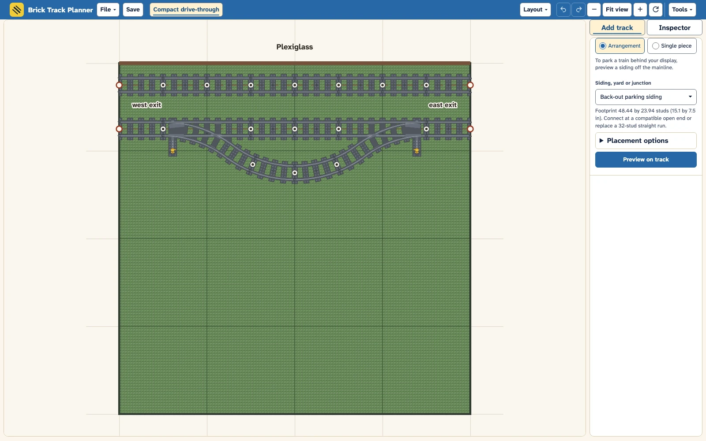
<!-- screenshots:end -->

#### PFS40 - Compact freight spur

<!-- screenshots:begin (managed by screenshot-docs) -->
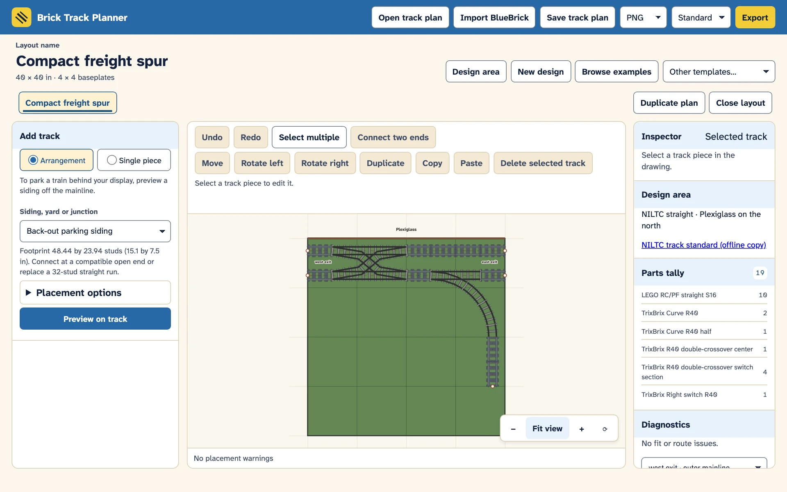
<!-- screenshots:end -->

### 100 by 70 inches

#### R104R - R104 three-quarter return

This return links the two mainlines at the same edge. It uses a 258.75-degree
R104 bend, a 25-stud diagonal, and a 78.75-degree R104 bend in the opposite
direction. [Download the editable track plan](../templates/r104-three-quarter-return.ldr)

<!-- screenshots:begin (managed by screenshot-docs) -->

<!-- screenshots:end -->

## Other templates

Open these plans from **Other templates** on the start screen or from **File**
in the editor. You can also download the [R104 right yard](../templates/member-yard.ldr),
[LEGO R40 left yard](../templates/member-r40-left-yard.ldr),
[R24 staging yard](../templates/member-r24-staging-yard.ldr),
[R104 semicircle return](../templates/r104-semicircle-return.ldr), or
[R120 corner return](../templates/r120-corner-return.ldr) and use
**Open track plan** in the planner.

### Member straight

<!-- screenshots:begin (managed by screenshot-docs) -->
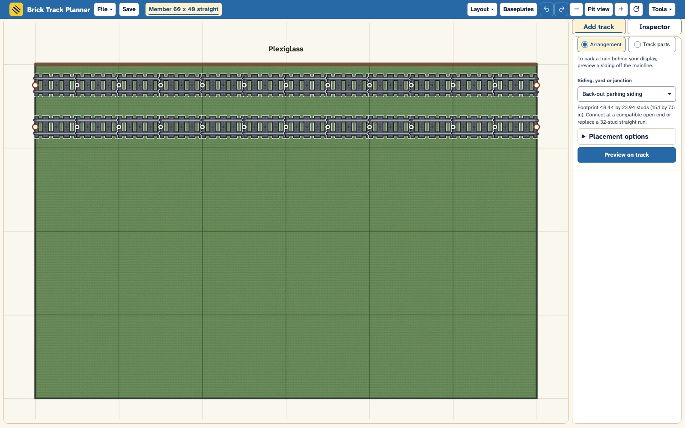
<!-- screenshots:end -->

### Member corner

<!-- screenshots:begin (managed by screenshot-docs) -->

<!-- screenshots:end -->

### Member R104 right yard

<!-- screenshots:begin (managed by screenshot-docs) -->

<!-- screenshots:end -->

### Member R40 left yard

Each stock 22.5-degree LEGO switch and full R40 reverse curve moves a storage
row 48 studs along and 16 studs back, so the yard needs no short filler
pieces. Where space permits, the rear row is a single 16-stud straight.

<!-- screenshots:begin (managed by screenshot-docs) -->

<!-- screenshots:end -->

### Member R24 staging yard

This 75 by 40 inch template has six sidings for staging cars and pushing
them by hand onto the inner mainline. The TrixBrix R24 ladder spans every
baseplate column. Both mainlines run straight through, and the staging
tracks end four studs inside the west edge.

<!-- screenshots:begin (managed by screenshot-docs) -->

<!-- screenshots:end -->

### R104 semicircle return

<!-- screenshots:begin (managed by screenshot-docs) -->
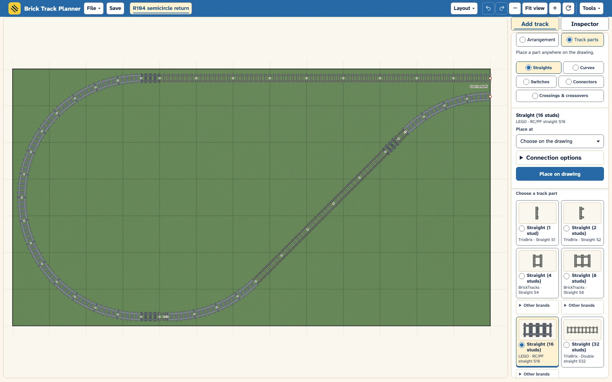
<!-- screenshots:end -->

### R120 corner return

<!-- screenshots:begin (managed by screenshot-docs) -->

<!-- screenshots:end -->

### Joel's 10-to-0 mainline

Roger's January 2024 Rockford drawing shows the mainline offset at Joel's
display. The [editable 60 by 40 inch template](../templates/joel-mainline-offset.ldr)
uses centered S-bends to shift both mainlines 10 inches, with R104 on the inside
of each bend and R120 on the outside. The lanes are 16 studs apart at both
handoffs. The planner chose the individual curves and straight lengths for
this template. The Rockford drawing leaves those parts unspecified.

<!-- screenshots:begin (managed by screenshot-docs) -->
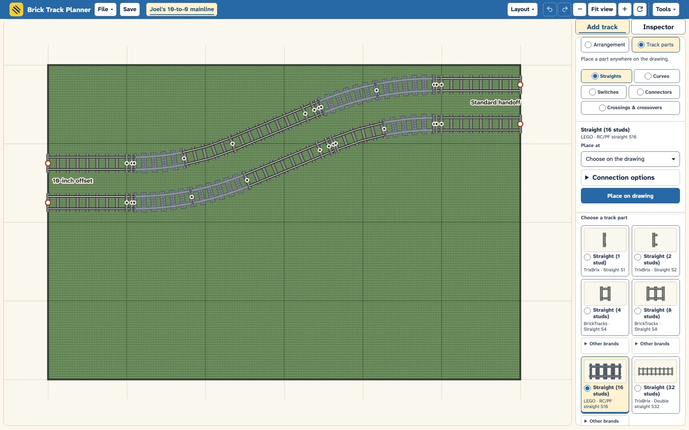
<!-- screenshots:end -->

## Recapture the collection

Use the local Pages build, Playwright Chromium, and the libwebp tools
`cwebp` and `img2webp`. Rebuild from the current checkout before capturing.
Run these commands from the repository root.

```bash
./build_github_pages.sh
source source_me.sh && bash tests/playwright/helper_pages_server.sh 4173
```

From a second terminal, capture to a temporary directory for inspection.

```bash
node tests/playwright/helper_readme_screenshots.mjs \
  http://127.0.0.1:4173/brick-track-planner/ /tmp/brick-track-planner-readme
```

The capture checks the served templates against the working tree. Inspect
each affected view and replace its WebP in `docs/screenshots/` with the
verified capture alongside the layout or interface change.

The desktop frames are 1600 by 1000 CSS pixels. The phone setup and editor
captures are 390 by 844 CSS pixels.
