# Planner screenshots

## Contents

- **Browse track examples** &middot; [60 &times; 40 inches](#60-by-40-inches)
  &middot; [40 &times; 40 inches](#40-by-40-inches)
  &middot; [Mainline loops](#mainline-loops) &middot; [Train yards](#train-yards)
- **Editor walkthrough** &middot; [Start a plan](#start-a-plan)
  &middot; [Change the baseplates](#change-the-baseplates)
  &middot; [Place track](#place-track)
  &middot; [Select several pieces](#select-several-pieces)
  &middot; [Compare two versions](#compare-two-versions)
  &middot; [Change the table outline](#change-the-table-outline)
- **[Phone screenshots](PHONE_SCREENSHOTS.md)** &middot; Setup, editor, and track picker
- [Other templates](#other-templates) &middot; [Recapture the collection](#recapture-the-collection)

Select any preview to open the full-size image.

## Track examples

The groups match **Browse examples** in the planner. Sizes give the width
along the track first. Select a layout name for its editable LDraw plan.

[See the in-app example picker](screenshots/straight_examples.webp).

### 60 by 40 inches

<!-- screenshots:begin (managed by screenshot-docs) -->
| Example | Preview |
| --- | --- |
| [ML &middot; Mainline only](../templates/01-mainline-only.ldr)<br>Keep both club lines clear and leave the full space behind them for your display. | <a href="screenshots/example_ml.webp">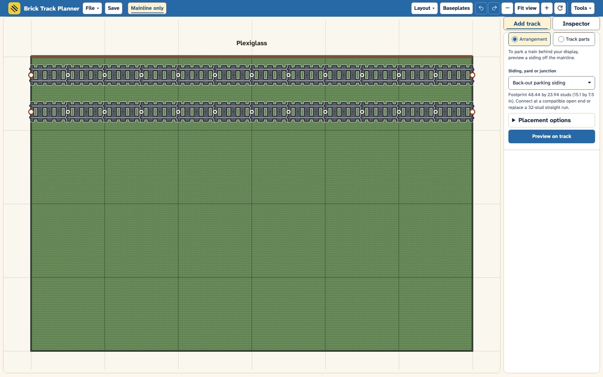</a> |
| [BOS &middot; Back-out siding](../templates/06-long-back-out.ldr)<br>Park on 64 straight studs along the front. Reverse to return to the inner mainline. | <a href="screenshots/example_bos.webp"></a> |
| [DCX &middot; Double crossover](../templates/07-double-crossover.ldr)<br>Transfer between the two club lines within the mainline corridor. | <a href="screenshots/example_dcx.webp"></a> |
| [JOEL &middot; Joel's 10-to-0 mainline](../templates/joel-mainline-offset.ldr)<br>Rockford offset with rerailer straights before, between, and after the bends on both lines.<br>[Joel's notes](#joels-10-to-0-mainline) | <a href="screenshots/joel_mainline_offset.webp"></a> |
| [DTS60 &middot; Drive-through siding](../templates/08-drive-through-siding.ldr)<br>Park on 80 straight studs between the two ends of the inner mainline. | <a href="screenshots/example_dts60.webp"></a> |
| [PT40 &middot; R40 right pass-through](../templates/r40_right_pass_through.ldr)<br>Cross from the outer mainline to the rear track while the middle line stays independent. | <a href="screenshots/example_pt40.webp"></a> |
| [PFS &middot; Dual perpendicular freight spurs](../templates/12-perpendicular-freight-spur-short.ldr)<br>From the west, either mainline serves both right-side spurs. Each has 32 straight studs. | <a href="screenshots/example_pfs.webp"></a> |
| [TJ40 &middot; R40 T-junction](../templates/r40_t_junction.ldr)<br>Reach a right-side spur from either end of the inner mainline. | <a href="screenshots/example_tj40.webp"></a> |
| [TJ56 &middot; R40&#8211;R56 T-junction](../templates/r40_r56_t_junction.ldr)<br>Use two perpendicular spurs on a private double-track line. | <a href="screenshots/example_tj56.webp"></a> |
| [MSBC &middot; Mirrored S-bend crossings](../templates/mirrored-s-bend-crossings.ldr)<br>Two pairs of tracks swap sides through four 45-degree crossings. The track footprint is about 20 inches deep. | <a href="screenshots/example_msbc.webp"></a> |
<!-- screenshots:end -->

#### Joel's 10-to-0 mainline

Roger's January 2024 Rockford drawing shows the mainline offset at Joel's
display. Joel described pairs of R120 curves on the outside of the turns and
pairs of R104 curves on the inside, with shorter straights to fit the offset
in just under 40 inches. The
[editable 60 by 40 inch template](../templates/joel-mainline-offset.ldr)
uses stock straights to model an approximately 10-inch shift. The outside
and inside tracks swap sides between the two turns. Joel would need to
reassemble the layout to confirm where the 1/4 and 1/10 pieces went.

Joel shelved the original design after some larger trains struggled with it.
The template uses six 16-stud LEGO crossing straights (6530143) with
smooth rerailing decks. Each line has one before the first bend, one on the
diagonal straight between the bends, and one after the second bend.

#### MSBC - Mirrored S-bend crossings

Two pairs of tracks swap sides across a 60 by 40 inch display. The R104 and
R120 S-bends shift each pair about 12.6 inches to leave room for four 45-degree
diamonds. Trains cross the other pair while staying on their own route.
The layout uses stock TrixBrix crossings, curves, and short straights with
LEGO S16 approaches. Its saved General design area is 60 by 40 inches, while
the centered crossing formation is about 20 inches deep.
[Download the editable plan](../templates/mirrored-s-bend-crossings.ldr).

### 40 by 40 inches

<!-- screenshots:begin (managed by screenshot-docs) -->
| Example | Preview |
| --- | --- |
| [ML40 &middot; Compact mainline](../templates/compact_mainline.ldr)<br>Keep the two club mainlines clear on a square display. | <a href="screenshots/example_ml40.webp">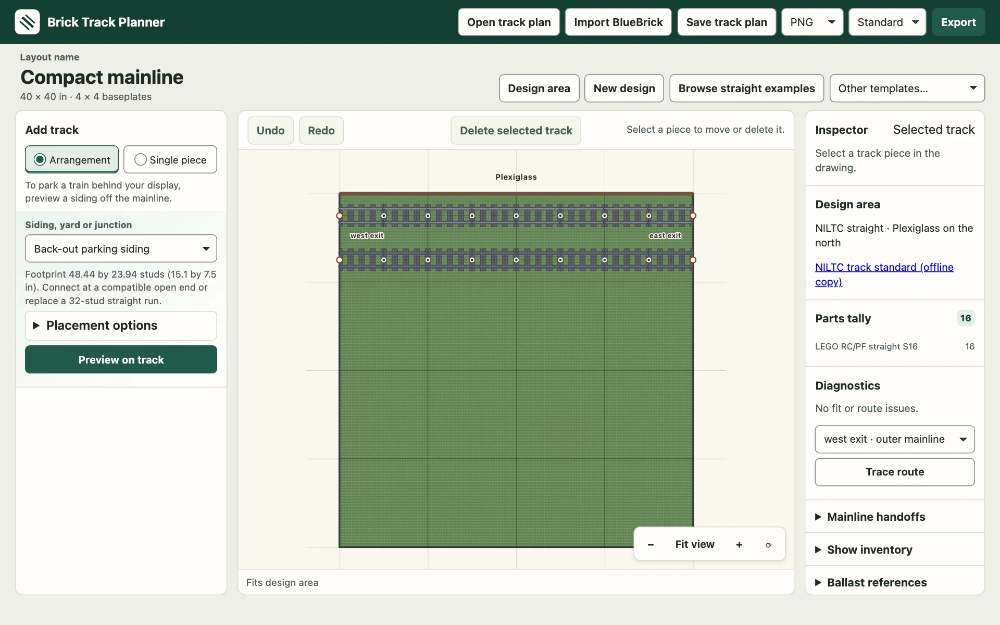</a> |
| [BOS40 &middot; Short back-out siding](../templates/compact_back_out.ldr)<br>Park on 32 straight studs behind the mainlines. Reverse to return to the inner line. | <a href="screenshots/example_bos40.webp">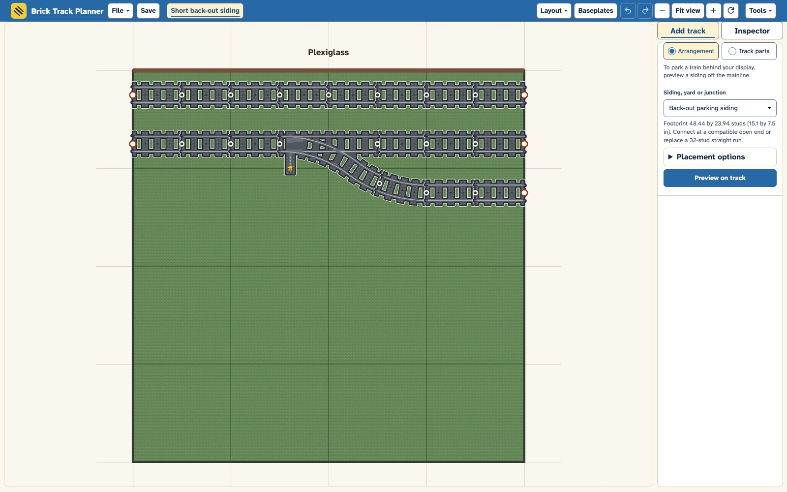</a> |
| [DCX40 &middot; Compact crossover](../templates/compact_crossover.ldr)<br>Transfer between the two club mainlines in a square display. | <a href="screenshots/example_dcx40.webp"></a> |
| [DTS40 &middot; Compact drive-through](../templates/compact_drive_through.ldr)<br>Leave and rejoin the inner mainline at opposite ends of the siding. | <a href="screenshots/example_dts40.webp"></a> |
| [PFS40 &middot; Compact freight spur](../templates/compact_freight_spur.ldr)<br>Reach a right-side spur from either west mainline. The spur has 32 straight studs. | <a href="screenshots/example_pfs40.webp"></a> |
<!-- screenshots:end -->

### Mainline loops

<!-- screenshots:begin (managed by screenshot-docs) -->
| Example | Preview |
| --- | --- |
| [R104R &middot; R104 &frac34;-circle return](../templates/r104-three-quarter-return.ldr)<br>100 &times; 70 inches<br>Return trains from one mainline to the other using only R104 curves. | <a href="screenshots/example_r104r.webp">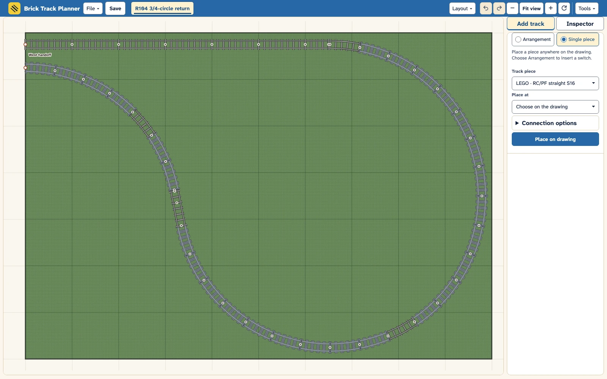</a> |
| [R104S &middot; R104 semicircle return](../templates/r104-semicircle-return.ldr)<br>130 &times; 70 inches<br>Turn back using an R104 semicircle and a long diagonal. | <a href="screenshots/r104_semicircle_return.webp"></a> |
| [R120R &middot; R120 corner return](../templates/r120-corner-return.ldr)<br>120 &times; 90 inches<br>Return through an R120 quarter-turn around a 30 by 30 inch corner cutout. | <a href="screenshots/r120_corner_return.webp">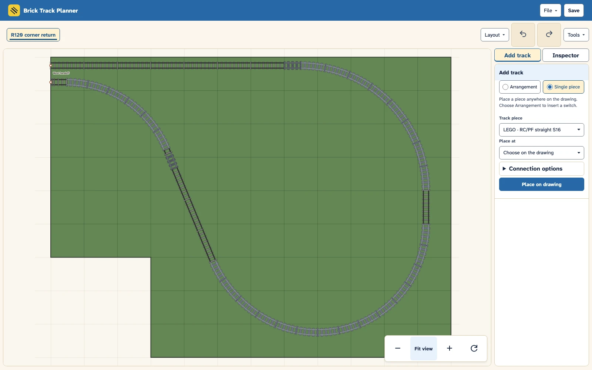</a> |
<!-- screenshots:end -->

#### R104R - R104 three-quarter return, 100 by 70 inches

This return links the two mainlines at the same edge. It uses a 258.75-degree
R104 bend, a 25-stud diagonal, and a 78.75-degree R104 bend in the opposite
direction. [Download the editable track plan](../templates/r104-three-quarter-return.ldr)

### Train yards

<!-- screenshots:begin (managed by screenshot-docs) -->
| Example | Preview |
| --- | --- |
| [4TRY &middot; Four-track right yard](../templates/04-r40-right-yard.ldr)<br>60 &times; 40 inches<br>Arrive from the west on either mainline. All three storage tracks end flush at the right edge. | <a href="screenshots/example_4try.webp"></a> |
| [8TRY &middot; Eight-track switch yard](../templates/eight_track_ladder_yard.ldr)<br>60 &times; 40 inches<br>Reach any row via alternating single crossovers. A diagonal links rows 8 and 1. | <a href="screenshots/example_8try.webp">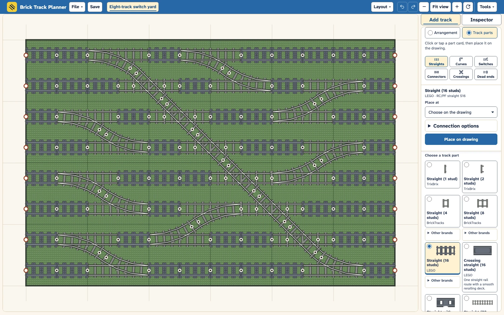</a> |
| [Y24 &middot; Member R24 staging yard](../templates/member-r24-staging-yard.ldr)<br>80 &times; 40 inches<br>Stage cars on six sidings at the west edge for hand-push operation. | <a href="screenshots/member_r24_staging_yard.webp">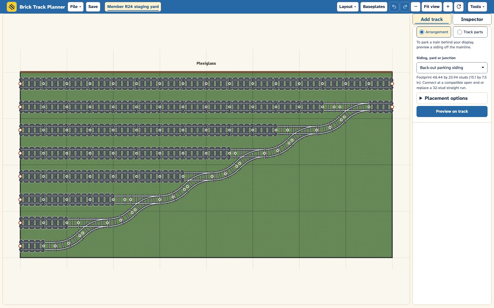</a> |
| [Y40 &middot; Member R40 left yard](../templates/member-r40-left-yard.ldr)<br>100 &times; 40 inches<br>Reach six west-edge storage tracks using standard LEGO R40 switches and curves. | <a href="screenshots/member_r40_left_yard.webp">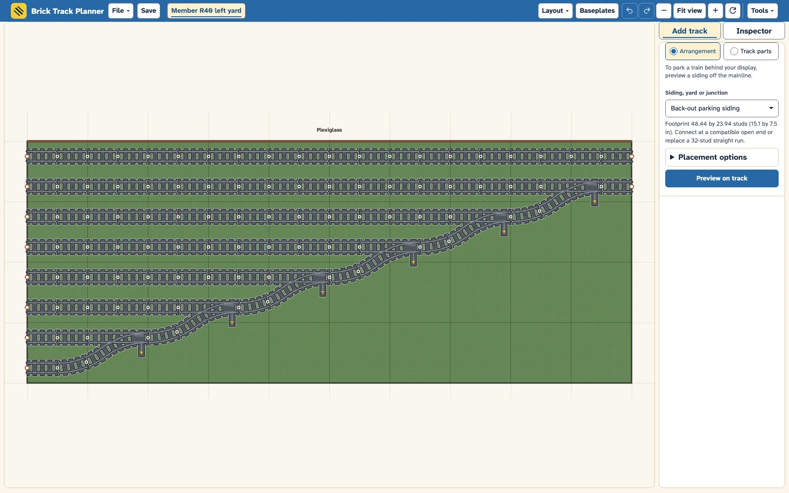</a> |
| [Y104 &middot; Member R104 right yard](../templates/member-yard.ldr)<br>100 &times; 40 inches<br>Reach six east-edge storage tracks from the inner mainline through an R104 ladder. | <a href="screenshots/member_r104_yard.webp">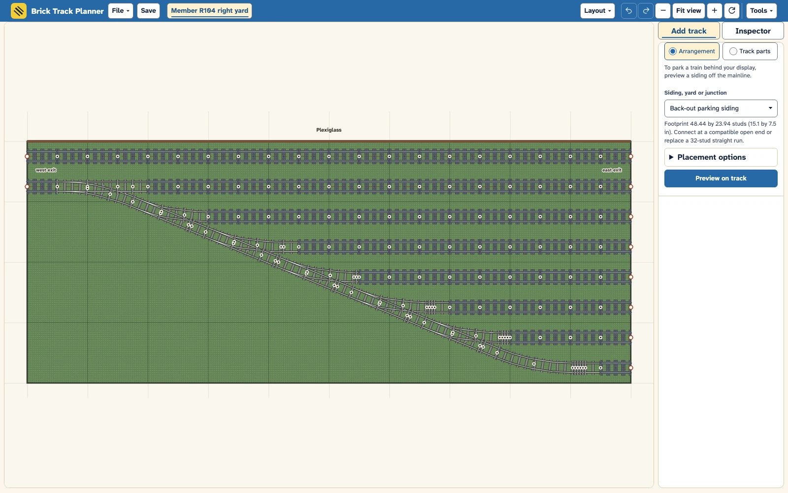</a> |
<!-- screenshots:end -->

#### 8TRY - Eight-track switch yard, 60 by 40 inches

Eight parallel rows run between the left and right edges. Seven alternating
R40 single crossovers connect adjacent rows. Each uses two matching switches
and a connector. The 45-degree diagonal connects the right end of row 8
directly to the left end of row 1.
([TrixBrix right switch](https://trixbrix.eu/en/p/track/switches-and-crossovers/right-switch-r40/9953-right-switch-r40),
[TrixBrix left switch](https://trixbrix.eu/en/p/track/switches-and-crossovers/switches-and-crossovers-r40/left-switch-r40/9937-left-switch-r40))

Every row is reachable with reversals. To get from row 8 to row 5, run left
to row 7, right to row 6, then left to row 5. Reverse after the train clears
the crossover. The shortest approach at a table edge is 16 studs. Longer trains
may need continuation track beyond the table for some moves. **Trace route**
shows one move at a time.

#### Member R24 staging yard, 80 by 40 inches

[Download the editable track plan](../templates/member-r24-staging-yard.ldr).

This 80 by 40 inch template has six sidings for staging cars and pushing
them by hand onto the inner mainline. The TrixBrix R24 ladder uses S4 and S8
spacers at the throat, so every track reaches the west edge and its LEGO S16
straight sections line up on the same grid. Both mainlines run straight through.

#### Member R40 left yard, 100 by 40 inches

[Download the editable track plan](../templates/member-r40-left-yard.ldr).

Each stock 22.5-degree LEGO switch and full R40 reverse curve moves a storage
row 48 studs along and 16 studs back, so the yard needs no short filler
pieces. Where space permits, the rear row is a single 16-stud straight.

## Start a plan

### Start screen

To try a layout right away, choose **Browse examples** and pick
**BOS** under **60 &times; 40 inches**. To start your own plan, enter your
assigned display size, choose a track shape, and select **Create track plan**.
Choose **Curve** to see both corner options.

<!-- screenshots:begin (managed by screenshot-docs) -->
<a href="screenshots/member_design_start.webp"></a>
<a href="screenshots/member_curve_options.webp">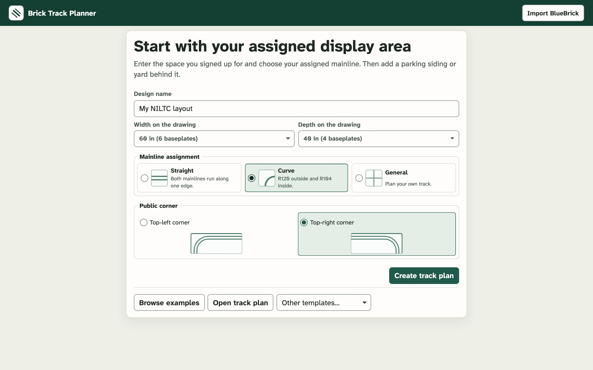</a>
<!-- screenshots:end -->

### Blank General editor

Choose **General** to start with an empty drawing and add the track
yourself.

<!-- screenshots:begin (managed by screenshot-docs) -->
<a href="screenshots/general_blank_start.webp"></a>
<!-- screenshots:end -->

### Straight member starter

Choose **Straight** to start with the two shared club tracks already in place.

<!-- screenshots:begin (managed by screenshot-docs) -->
<a href="screenshots/member_mainline_start.webp">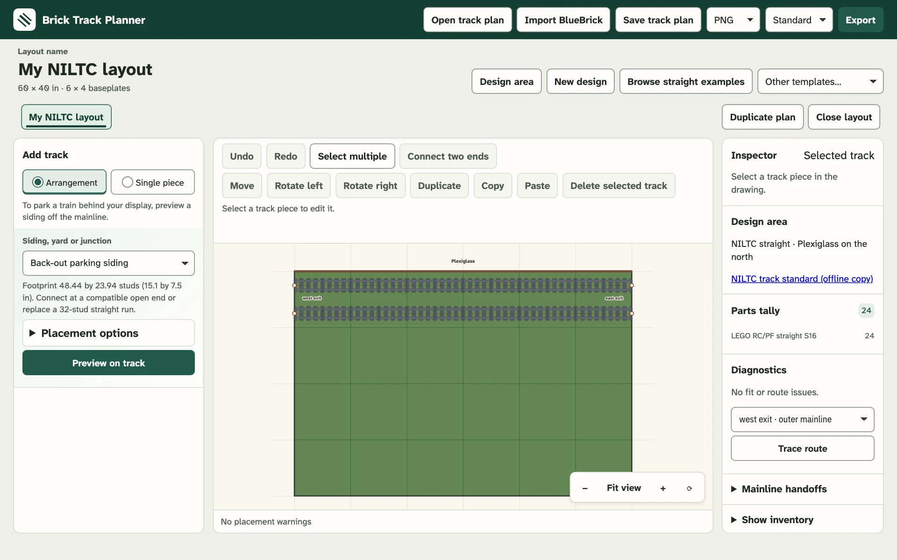</a>
<!-- screenshots:end -->

## Change the baseplates

Select **Baseplates** next to **Layout**, choose a pattern and colors, and
check the preview. Choose **Apply baseplates** to use them on the drawing.

<!-- screenshots:begin (managed by screenshot-docs) -->
<a href="screenshots/baseplate_patterns.webp">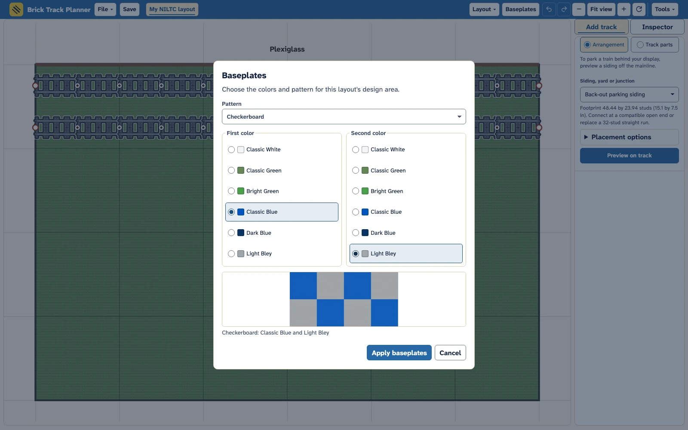</a>
<!-- screenshots:end -->

## Place track

### Preview and add a siding

In a Straight plan, keep **Back-out parking siding** selected. Choose
**Preview on track** to see where the siding fits, then **Add to layout** to
put it in the plan.

<!-- screenshots:begin (managed by screenshot-docs) -->
<a href="screenshots/member_parking_siding_preview.webp"></a>
<a href="screenshots/member_parking_siding.webp"></a>
<!-- screenshots:end -->

### Browse track parts

Choose **Track parts** in a General plan. Pick a visible category, then choose
a card by its drawing and measurement. The smaller manufacturer line identifies
the physical part. Point at a desktop card for its exact model, which also
appears in the selected-part summary. Use **Other brands** for an equivalent
part or **More track parts** for a replacement section.
[See the phone part picker](PHONE_SCREENSHOTS.md#browse-track-parts).

<!-- screenshots:begin (managed by screenshot-docs) -->
<a href="screenshots/track_parts_switches.webp"></a>
<a href="screenshots/mobile_track_parts.webp">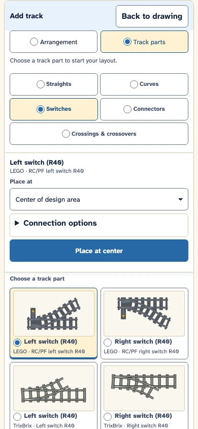</a>
<!-- screenshots:end -->

### Place a track part

Click a track part card to pick up the piece. Move the pointer over the
drawing to see where it will go, then click to place it. On a touch screen,
tap the card and then tap the drawing. Drag the placed piece or choose
**Move** to reposition it.

<!-- screenshots:begin (managed by screenshot-docs) -->
<a href="screenshots/place_single_track_demo.webp">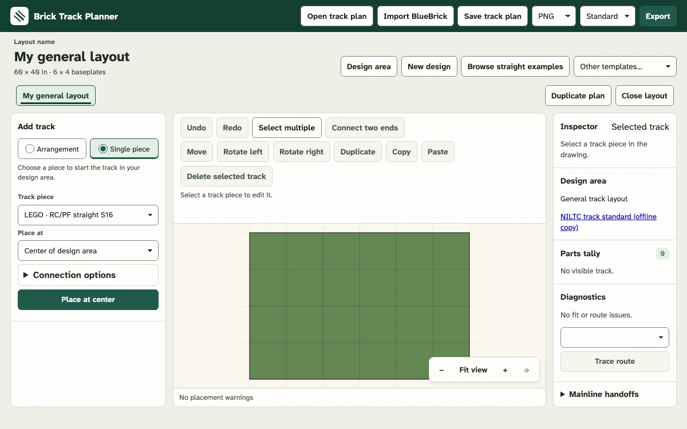</a>
<!-- screenshots:end -->

## Select several pieces

Hold **Command** on Mac or **Ctrl** elsewhere and drag a box that fully
encloses the pieces. Hold the same key and click to add or remove one
piece. On touch, choose **Select multiple** and tap the pieces. Choose
**Move** or **Delete selected track** to act on the whole selection. Click
overlapping track to select the top piece, then choose **Next track here** to
cycle the stack. Drag the selected piece or selection, even when another piece
covers it. The placement grid control sets the step for the next drag or Move.

<!-- screenshots:begin (managed by screenshot-docs) -->
<a href="screenshots/select_multiple_track.webp"></a>
<a href="screenshots/mouse_overlap_selection.webp">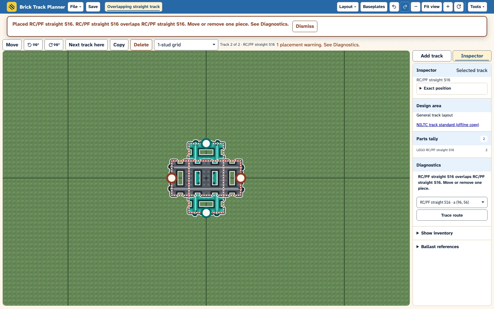</a>
<!-- screenshots:end -->

## Compare two versions

Open **Layout**, choose **Duplicate plan**, and give the copy a short name in
**Layout name**. Edit the copy, then click either tab to compare the two
versions. Use the direct **Save** button from each tab you want to keep.

<!-- screenshots:begin (managed by screenshot-docs) -->
<a href="screenshots/layout_tabs.webp">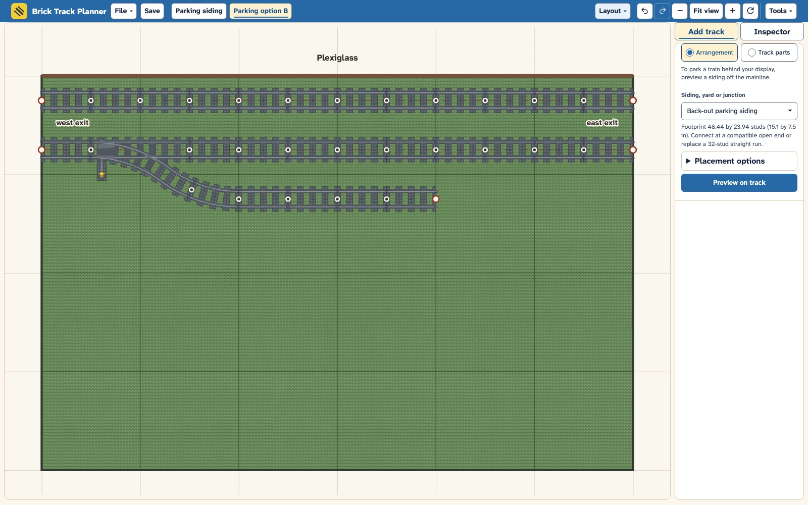</a>
<!-- screenshots:end -->

## Change the table outline

In a Straight plan, open **Layout** and choose **Design area**, select the
north edge, and choose **Shift a span**. Start 10 inches from the left, set
the span to 20 inches, and move it 5 inches toward the selected edge. The
dashed line marks the original outline. The opposite edge moves inward by the
same amount.

<!-- screenshots:begin (managed by screenshot-docs) -->
<a href="screenshots/member_table_shift.webp"></a>
<!-- screenshots:end -->

When the mainline rails themselves are offset, see [Joel's 10-to-0 mainline](#joels-10-to-0-mainline).

## Other templates

Open these starter plans from **Other templates** on the start screen or
under **File** in the editor. The same menu includes the semicircle return,
corner return, three member yards, and Joel's mainline offset.

### Member straight

<!-- screenshots:begin (managed by screenshot-docs) -->
<a href="screenshots/member_straight.webp"></a>
<!-- screenshots:end -->

### Member corner

<!-- screenshots:begin (managed by screenshot-docs) -->
<a href="screenshots/member_corner.webp"></a>
<!-- screenshots:end -->

### Color-coded track view

Open **Layout** and choose **Color-coded track** to switch from detailed track
artwork to a planning view. The member corner shows the familiar L-Gauge
colors, including blue R104 and burgundy R120 curves, with each track's type
printed directly on it.

<!-- screenshots:begin (managed by screenshot-docs) -->
<a href="screenshots/track_color_view.webp">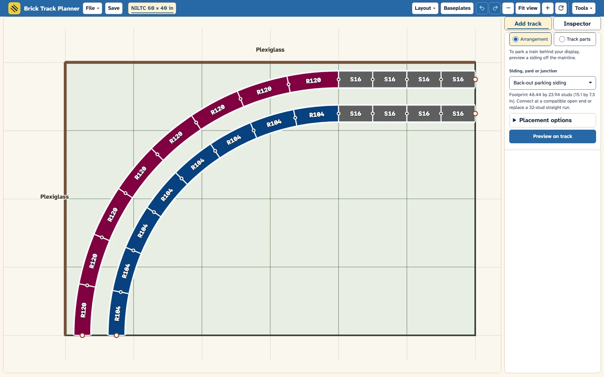</a>
<!-- screenshots:end -->

## Recapture the collection

Use the local Pages build, Playwright Chromium, and the libwebp tools
`cwebp` and `img2webp`. Rebuild from the current checkout before capturing.
Run these commands from the repository root.

```bash
./build_github_pages.sh
source source_me.sh && bash tests/playwright/helper_pages_server.sh 4173
```

From a second terminal, capture to a temporary directory for inspection.

```bash
node tests/playwright/helper_readme_screenshots.mjs \
  http://127.0.0.1:4173/brick-track-planner/ /tmp/brick-track-planner-readme
```

Inspect each affected view and replace its WebP in `docs/screenshots/` with the
verified capture alongside the layout or interface change.

The desktop frames are 1600 by 1000 CSS pixels. The phone setup and editor
captures are 390 by 844 CSS pixels.
