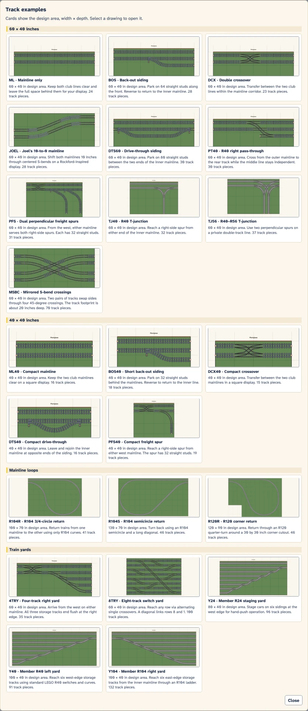
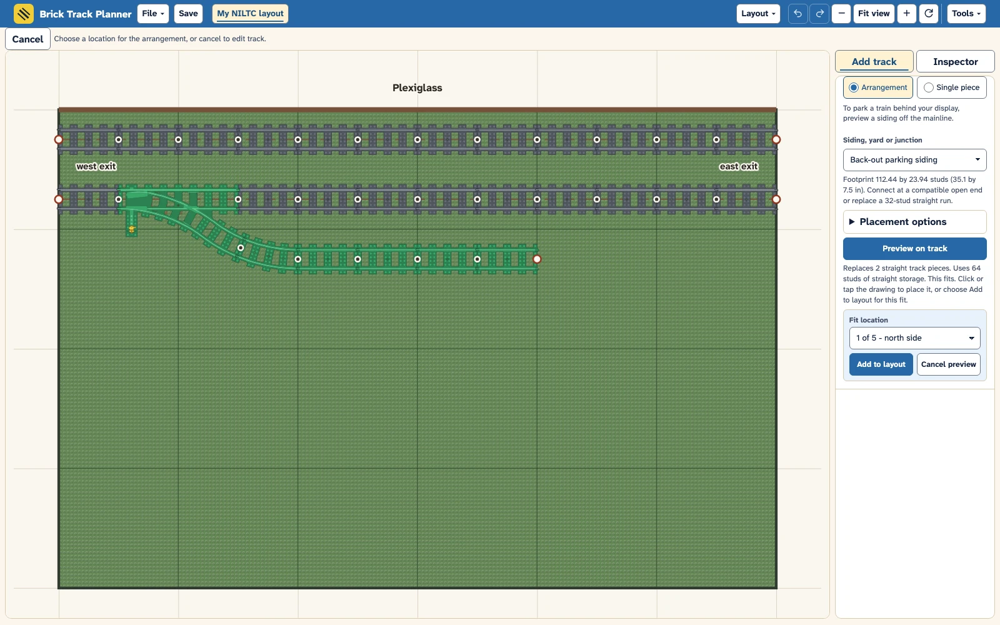

# Usage

## Start a member design

The first screen starts a member design. Enter the width along the track and
the depth from the plexiglass. Common values are expressed in inches and
baseplates, and **Other** accepts a specific size.

The start screen keeps direct **Open track plan**, **Browse examples**,
**Other templates**, and **Import BlueBrick** choices alongside the new-design
form.

The default NILTC depth is 40 inches. For a common 60 by 40 inch display,
choose 60 inches for the width, 40 inches for the depth, and **Straight**,
then choose **Create track plan**. The editor opens with both mainlines and
the automatic baseplate grid already in place.

Choose the assigned mainline shape.

- **Straight** puts both NILTC mainlines along the top plexiglass edge.
- **Curve** shows a drawing of each public corner. Choose the top-left or
  top-right bend for the R120 outer line and R104 inner line. The width and
  depth stay on the same drawing axes.
- **General layout** creates a fully covered design area without a NILTC
  mainline.

Use **Open track plan** to continue an LDraw file saved by this planner.
**Other templates** includes the 60 by 40 straight, the corner, the 100 by 40
inch R104 yard with six right-edge storage tracks, the 130 by 70 inch R104
semicircle return, and the 120 by 90 inch R120 corner return with a 30 by 30
inch corner cutout. Each turnaround links the two approach tracks at the same edge.
[See the turnarounds](SCREENSHOTS.md#mainline-loops).
Joel's 10-to-0 mainline adapts the Rockford offset to a 60 by 40 inch table
with a 10-inch shift between its two display edges. [See the mainline offset](SCREENSHOTS.md#joels-10-to-0-mainline).

The area is the member's usable display space. It is not a physical table map.
The planner draws the 32-stud baseplate grid automatically, so members plan
track instead of moving baseplates.

## Compare track examples

Choose **Browse examples** on the start screen or under **File** in the editor.
The 60 by 40 and 40 by 40 inch collections organize compact display plans by
size; each begins with the mainline and back-out siding, then orders the
remaining plans by physical track piece count. **Mainline loops** collects the
three return plans. **Train yards**
collects storage and staging plans, including the 100 by 40 inch R104 and R40
yards and the 80 by 40 inch R24 staging yard. Each card gives its design-area
dimensions. All existing choices remain under **Other templates**.

Use **PFS** for two perpendicular freight spurs on the right. Each has 32
straight studs with room to extend. Use **4TRY** for three storage tracks
ending flush at the right edge. Trains entering from the west on either
mainline can reach every storage track in both examples without reversing.
For the square display, **PFS40** gives the same access to a single spur.
**DTS60** fits 80 straight studs of storage into the drive-through siding,
with a short lead at each end.

**PT40** connects the outer mainline to a third track while the middle track
runs straight through. **TJ40** serves one perpendicular spur from either
end of the inner mainline. **TJ56** demonstrates two perpendicular spurs on
a private double-track line using a General plan.

Choose a drawing to open it in a new layout tab and edit the track. Opening
another example keeps your existing layouts open. **Close** leaves the
gallery and returns to the current layout.

<!-- screenshots:begin (managed by screenshot-docs) -->

<!-- screenshots:end -->

[See each example in the editor](SCREENSHOTS.md#track-examples).

## Work with layout tabs

**New design**, **Open track plan**, templates, examples, and accepted
BlueBrick imports each open another layout tab above the drawing. In the editor,
find these commands under **File**. Choose a tab to switch layouts. Each keeps
its edits, Undo/Redo history, pan, zoom, and view rotation. Open **Layout** to
rename the active layout, change its design area, duplicate it, or close it.

On a keyboard, tab into the layout strip. Arrow keys move between tab names.
**Home** and **End** reach either end. **Enter** or **Space** opens the focused
layout. On touch, tap a tab and scroll the strip to reach more layouts.
Switching layouts cancels an unfinished placement preview.

### Copy between two yards

1. Open **File**, then use **Open track plan** twice to open Yard A and Yard B,
   or open two examples.
2. In Yard A, select the track to copy. Use **Shift+click** or **Select multiple**
   for several pieces. For a complete installed siding, select one piece and
   open **Tools** and choose **Select arrangement**.
3. Choose **Copy**, switch to Yard B, then choose **Paste**.
4. Point to a destination to preview the copy, then click or tap to place it.
   If the track overlaps, the planner flags it after placement. **Esc** or
   **Cancel** cancels an unfinished preview.

The source stays intact. A successful placement is one undoable edit. The
next click selects track and leaves the copy in place. The pieces retain
their relative positions and internal joints. **Copy** and **Paste** also
accept **Command+C** and **Command+V** on macOS, or **Ctrl+C** and **Ctrl+V**
elsewhere. The copied selection remains available after switching layouts
or closing its source. Choose **Paste** again for another independent copy.

### Compare an edited variant

1. Open the original layout and choose the view you want to compare.
2. Open **Layout** and choose **Duplicate plan**. The new tab includes your unsaved edits and starts
   at the same view, with a name such as `East yard (copy)`.
3. Open **Layout**, rename the copy in **Layout name**, then edit its track.
4. Switch between the original and copy to compare. Edits and later view
   changes in either layout leave the other alone.
5. Choose **Save** in each layout you want to keep.

## Change the table outline

Open **Layout**, then choose **Design area**. Pick the edge and enter how far
to move it. You can extend or trim any side. For a NILTC layout, use 10-inch
steps to move a full edge, or choose **Shift a span** to offset part of a table
in 5-inch steps. A 5-inch bump-out on one side moves the opposite edge in by
5 inches along the same span, keeping the table depth there. Measure the
span's start from the left of a horizontal edge or the top of a vertical edge.
General layouts can also extend or trim a span on one side, to the nearest stud.

The preview shows the old outline and highlights track that would extend past
the new edge. Ordinary diagnostics remain available after the outline changes.
Choose **Apply outline** to make one undoable edit with the track in place.
The drawing's overall dimensions include bump-outs. Save the layout to keep
the outline with the track plan.
[See the paired shift preview](SCREENSHOTS.md#change-the-table-outline).

## Add track that solves a layout job

For a NILTC assignment, **Add track** starts in **Arrangement** mode. It is the
quickest way to add a useful connected build. A **General** layout starts in
**Track parts** mode so you can begin its track. On desktop, use the **Add track**
sidebar switch. On phones, choose **Add track** below the drawing. **Back to drawing**
returns to the canvas and **Show drawing** brings an active siding preview back into view.

1. Keep **Back-out parking siding** selected.
2. Choose **Preview on track**. The preview identifies an aligned replacement
   on the mainline and the storage length that fits your area.
3. Choose **Add to layout** when the highlighted placement is the one you want.
   This uses the selected recommendation. You can also click near a suggested
   fit on the drawing to use it, or click elsewhere to drop the whole preview
   there while leaving the existing track in place.

<!-- screenshots:begin (managed by screenshot-docs) -->

<!-- screenshots:end -->

Open **Placement options** before previewing and choose 32 or 0 studs of
added straight storage if you want a shorter siding.

Choose **Track parts** to lay an individual rail. Start with the visible
**Straights**, **Curves**, **Switches**, **Crossings & crossovers**, or
**Connectors** categories. The selected card names the shape and measurement
first, then its manufacturer. On a desktop, point at a card to see its exact
model. The selected-part summary always shows the complete manufacturer and
model. **Other brands** shows interchangeable alternatives. **More track
parts** contains replacement sections and specialty connectors. Choose
**Arrangement** for a complete multipart switch, yard, or junction.

In an empty general layout, the default target is the center of the design
area. Choose **Place at center** to start there. Choose **Choose on the
drawing** when you want to pick the location yourself. When exactly one private
rail end is open, it is selected for you. Choose **Connect part** to extend
it. A single part or copied selection drops once, then the next click selects
track. After choosing **Place on drawing**, press **Esc** before the drawing
click to cancel. [Watch the first part being placed](SCREENSHOTS.md#place-a-track-part).

The arrangement picker shows the selected kit's footprint and the track it
needs. A connected-fit preview highlights the changes. If no connected fit is
available, the message below **Preview on track** explains why, and the whole
kit remains available to place. Click anywhere in the drawing to drop it and
return to track selection, even without a connected fit. Overlapping pieces
appear in red after placement. Open **Diagnostics** to find the problem.
You can also change the placement options and preview again.

Connected-fit recommendations align compatible rail ends. Free placement still
lets you put the kit down; overlap findings remain available for repair.

- **Parking siding** creates a back-out or drive-through place behind the
  mainline.
- **Double crossover** changes between two parallel tracks.
- **Right pass-through single crossover R40** changes between the two outer
  tracks across a separate middle route. It fits three 32-stud straight runs
  at 16-stud spacing.
- **T-junction R40** branches from an 80-stud straight run to a perpendicular
  track. **T-junction R40-R56** branches from two 96-stud straight runs at
  16-stud spacing to two perpendicular tracks.
- **Triple switch** opens three routes from one entrance. Choose it on an open
  track or a free area, choose **Preview on track**, then use **Fit location**
  to choose between available placements before **Add to layout**.
- **Four-track drive-through yard** uses opposite-handed R40 yard ladders and
  joins all four storage tracks at both ends. Its selected storage length is
  measured from the shortest track. It needs 192 studs plus the selected
  storage length; use at least a 100 by 60 inch straight area for the default
  64-stud choice.
- **Two-way R104 turnback wye** is a measured R104 wye with mirrored turnouts,
  R104Y adapters, a tail lead, and a two-direction mainline closure.
  Its 32-stud tail fits in a 100 by 60 inch area; use 100 by 70 inches for a
  64-stud tail.

For a 100 by 40 inch example, open **File**, then choose **Member yard** under
**Other templates**.
The inner mainline feeds six parallel storage tracks through the R104 ladder.
All six storage tracks and both mainlines reach the right edge.
[See the 100 by 40 inch R104 yard](screenshots/member_r104_yard.webp).

TrixBrix product sets can include required specialty connectors and separately
sold entrance switches. The inventory lists each placed physical part, rather
than treating a product photo as one imaginary piece.

Choose a start connector in **Trace from**, then choose **Trace route** and
click a storage track or another connector. The route follows real port pairs
inside switches and across joined track ends. It does not treat a crossing as a
turn where no rail joins.

## Build to the club mainline

NILTC starters use the club's 8- and 24-stud lane positions. They are useful
starting geometry, not a requirement that restricts
editing. Every plan uses the same ordinary fit diagnostics, and General layouts
have no required mainlines. Members remain free to choose a compact private
yard design.

The mainline assignment comes from Roger. The planner designs a buildable
version of that assignment inside the member's display area.

## Edit and inspect

With a mouse, click a visible rail or ballast area to select the top track
piece. If pieces overlap, choose **Next track here** to cycle through them
([see the controls](SCREENSHOTS.md#select-several-pieces)).
Drag the selected piece or selection to move it, including a piece underneath
another. Starting a drag in the empty space between crossover routes pans the
drawing. On touch, tap a piece and choose **Move**, then tap the destination or
press anywhere in the drawing, drag to the destination, and release. Any held
copy, single part, or kit also goes down with a tap or one-finger drag and
release. You can put track down even when the destination needs repair. You
can also select track and choose **Move**, then click the destination.

Press **Esc** at any point in a drag to cancel. Releasing a direct drag outside
the drawing cancels it; an explicit **Move** stays ready so you can try again.
After panning the view with the mouse wheel, the preview refreshes at the
pointer's current position. For rail-end snapping, grab near an exposed rail
end and keep the pointer close to it; the nearest end guides the joint preview.
If equally close valid rail snaps compete, the preview falls back to the grid
and reports the ambiguity.

Press **Command+A** on Mac or **Ctrl+A** elsewhere to select all visible track
in the current layout. With a text field focused, the shortcut selects its text.
Hold **Command** or **Ctrl** and click to toggle one piece. Keep the mouse
button down and drag to draw a selection box. Release to add the fully enclosed
pieces to the selection, including when you release beyond the drawing edge.
**Shift+click** and **Select multiple** under **Tools** also work for individual
pieces. For an installed kit, choose one of its pieces, then open **Tools** and
choose **Select arrangement**.

Choose **Move** to move the selection together and keep its internal joints.
The preview marks any joints to stationary track that the move opens.
Choose **Delete** or press **Delete** to remove the selection in one edit.
Boundary track uses the same **Track parts**, **Move**, **Rotate**, and
**Delete** tools as all other track. To replace a rail with a switch or another
part, select the part and place it normally. Track can extend past the border
to connect to the next display.

Before a drag, use **Rail ends or 8-stud grid** or **1-stud grid** to choose
how the next translation moves; the same control is available for **Move**.
The choice resets after a move finishes or is canceled, and when you change
layout tabs. By default, moves snap to compatible open rail ends and otherwise
shift in 8-stud steps. **1-stud grid** bypasses automatic rail-end snapping
and moves in 1-stud steps. For a
single part you can enter X and Y in studs under **Exact position** in the
inspector. On desktop, use the **Inspector** sidebar switch. On phones, choose
**Inspector** in the toolbar to jump to the panel below the drawing. X
increases to the right and Y increases down.
**Tools** offers **Rotate left**, **Rotate right**, and **Duplicate** for a
single part. Each rotation is 90 degrees. The Undo and Redo icon buttons show
their names on hover or keyboard focus and apply one design operation at a time.

Choose **Duplicate** to copy one selected piece within the current layout.
Click or tap the destination to place it. Use **Copy** and **Paste** for
selected pieces or a complete siding, including between layout tabs as
described above. You can put track down even when it does not fit. Review the
flagged track, then move or delete it to fix the problem.

To fill a straight gap, open **Tools**, choose **Connect two ends**, and select two open
rail ends. The ends need to face each other on the same line. Review the gap
length and parts, then choose **Place**. To add
a larger component for a turn or branch, preview it in **Arrangement** and
choose **Add to layout**.

With the keyboard, tab to a piece and press **Enter** to select it. Use the
arrow keys to move selected track one stud per press in the direction shown
on the drawing. Each step can be undone and bypasses rail-end snapping. After
choosing **Move**, **Duplicate**, or paste, press **Enter** on a highlighted
rail end to snap to it, or on the drawing to use the center of the view.
Press **Esc** to cancel an active placement.

Use empty-space drag, Space-drag, or two-finger scroll to pan with a mouse
or trackpad. On touch, when no track is held, drag one finger anywhere in the
drawing, including over track, to pan. Pinch with two fingers to zoom.
**Fit view**, zoom, and view rotation share the top bar with Undo and Redo.
View rotation turns the drawing while keeping each track piece in place.
The icons show their names on hover or keyboard focus.

Choose **Layout > Color-coded track** to switch between detailed parts and a
color-coded drawing. The drawing labels curves by radius (such as R104) and
straights by length in studs (such as S16). Zoom in to read the smaller labels,
or select a part to see its full name in **Inspector**. Colors follow the
[L-Gauge Schematic Color library for BlueBrick](https://l-gauge.org/wiki/index.php/CAD_Tools).
Each open layout remembers its view while the editor is open.

The parts panel totals physical pieces in the current design. **Diagnostics**
reports overlaps and imported parts without usable geometry. Track may
extend past the design-area border. Findings follow the current layout,
including after saving and reopening, and clear when you fix the problem.
Open rail ends mark connection points while placing or tracing track. The
route panel highlights the selected path.

## Save and export

**Save** downloads the active layout as an editable LDraw `.ldr`
file using its layout name. Switch tabs and save each layout you want to keep.
Share that file with other LDraw users or open **File** and use **Open track plan** to continue working on it here.
The planner opens the track files it creates, including its templates.
**Import BlueBrick** on the start screen or under **File** creates a
reviewable flat track plan in the current design-area model and identifies any
part the catalog cannot place. Source elevations do not create elevated track.

Open **File** to choose PNG or WebP for a drawing, or PDF for a member build sheet with
design area dimensions, public edge, assigned mainline, drawing,
route information, and parts list. Exports use the active layout and do not
save its editable track plan. PDF export preserves the layout's colors. Use
the printer's black-and-white setting when a monochrome handout is needed.

Open **Layout** and choose **Close layout** to close the active tab. With unsaved changes, choose
**Keep editing** or press **Esc** to keep it open. **Discard changes** closes
it. An unchanged file or template closes immediately, as does a layout
unchanged since its last save. New designs, duplicates, and BlueBrick imports
need a save to close without that prompt. Closing the last layout returns
to the start screen.

Open tabs, their views and histories, and the copied selection last only for
the current planner session. Save every layout you want to keep before
reloading the page or closing the browser window, then reopen the `.ldr`
files in a later session.
